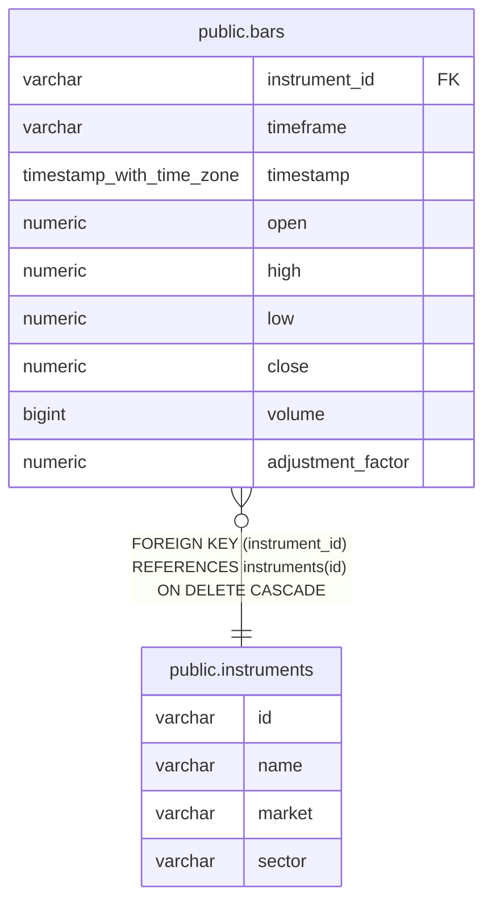

# public.bars

## Description

銘柄ごとの 1 分足、1 時間足、日足の価格と出来高を保持する。

## Columns

| Name              | Type                     | Default | Nullable | Children | Parents                                     | Comment                                                                                               |
| ----------------- | ------------------------ | ------- | -------- | -------- | ------------------------------------------- | ----------------------------------------------------------------------------------------------------- |
| instrument_id     | varchar                  |         | false    |          | [public.instruments](public.instruments.md) | バーの銘柄コード。                                                                                    |
| timeframe         | varchar                  |         | false    |          |                                             | バーの時間足。1 分足、1 時間足、日足を区別する。                                                      |
| timestamp         | timestamp with time zone |         | false    |          |                                             | バーの時刻。                                                                                          |
| open              | numeric                  |         | false    |          |                                             | 調整後の始値。                                                                                        |
| high              | numeric                  |         | false    |          |                                             | 調整後の高値。                                                                                        |
| low               | numeric                  |         | false    |          |                                             | 調整後の安値。                                                                                        |
| close             | numeric                  |         | false    |          |                                             | 調整後の終値。                                                                                        |
| volume            | bigint                   |         | false    |          |                                             | 調整後の出来高。                                                                                      |
| adjustment_factor | numeric                  | 1       | false    |          |                                             | 価格調整の発生日の日足に付与する係数。国内株は J-Quants、米国株は Alpaca の株式分割比率から設定する。 |

## Constraints

| Name                    | Type        | Definition                                                                                                                     |
| ----------------------- | ----------- | ------------------------------------------------------------------------------------------------------------------------------ |
| bars_timeframe_check    | CHECK       | CHECK (((timeframe)::text = ANY ((ARRAY['1m'::character varying, '1h'::character varying, '1d'::character varying])::text[]))) |
| bars_instrument_id_fkey | FOREIGN KEY | FOREIGN KEY (instrument_id) REFERENCES instruments(id) ON DELETE CASCADE                                                       |
| bars_pkey               | PRIMARY KEY | PRIMARY KEY (instrument_id, timeframe, "timestamp")                                                                            |

## Indexes

| Name               | Definition                                                                                       |
| ------------------ | ------------------------------------------------------------------------------------------------ |
| bars_pkey          | CREATE UNIQUE INDEX bars_pkey ON public.bars USING btree (instrument_id, timeframe, "timestamp") |
| bars_timestamp_idx | CREATE INDEX bars_timestamp_idx ON public.bars USING btree ("timestamp" DESC)                    |

## Relations

---

> Generated by [tbls](https://github.com/k1LoW/tbls)
