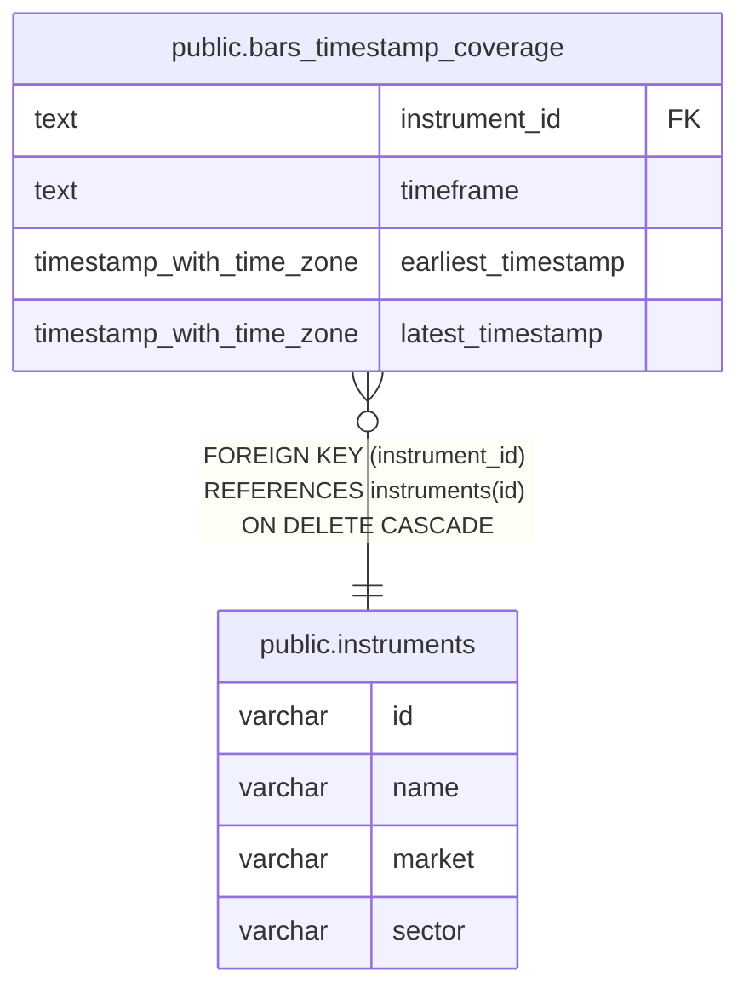

# public.bars_timestamp_coverage

## Description

銘柄と時間足ごとの最古・最新のバー時刻を保持する。

## Columns

| Name               | Type                     | Default | Nullable | Children | Parents                                     | Comment                        |
| ------------------ | ------------------------ | ------- | -------- | -------- | ------------------------------------------- | ------------------------------ |
| instrument_id      | text                     |         | false    |          | [public.instruments](public.instruments.md) | バーの銘柄コード。             |
| timeframe          | text                     |         | false    |          |                                             | バーの時間足。                 |
| earliest_timestamp | timestamp with time zone |         | false    |          |                                             | 保存されている最古のバー時刻。 |
| latest_timestamp   | timestamp with time zone |         | false    |          |                                             | 保存されている最新のバー時刻。 |

## Constraints

| Name                                       | Type        | Definition                                                               |
| ------------------------------------------ | ----------- | ------------------------------------------------------------------------ |
| bars_timestamp_coverage_timeframe_check    | CHECK       | CHECK ((timeframe = ANY (ARRAY['1m'::text, '1h'::text, '1d'::text])))    |
| bars_timestamp_coverage_instrument_id_fkey | FOREIGN KEY | FOREIGN KEY (instrument_id) REFERENCES instruments(id) ON DELETE CASCADE |
| bars_timestamp_coverage_pkey               | PRIMARY KEY | PRIMARY KEY (instrument_id, timeframe)                                   |

## Indexes

| Name                         | Definition                                                                                                                |
| ---------------------------- | ------------------------------------------------------------------------------------------------------------------------- |
| bars_timestamp_coverage_pkey | CREATE UNIQUE INDEX bars_timestamp_coverage_pkey ON public.bars_timestamp_coverage USING btree (instrument_id, timeframe) |

## Relations

---

> Generated by [tbls](https://github.com/k1LoW/tbls)
