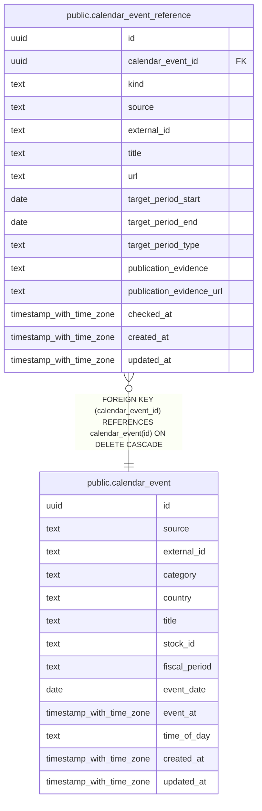

# public.calendar_event_reference

## Description

カレンダーイベントに対応する実績要約や公式資料への参照先と確認根拠を保持する。

## Columns

| Name                     | Type                     | Default           | Nullable | Children | Parents                                           | Comment                                                                            |
| ------------------------ | ------------------------ | ----------------- | -------- | -------- | ------------------------------------------------- | ---------------------------------------------------------------------------------- |
| id                       | uuid                     | gen_random_uuid() | false    |          |                                                   |                                                                                    |
| calendar_event_id        | uuid                     |                   | false    |          | [public.calendar_event](public.calendar_event.md) | 参照先が対応するカレンダーイベント。                                               |
| kind                     | text                     |                   | false    |          |                                                   | 参照先の種類。earnings_summary、individual_document、official_listing のいずれか。 |
| source                   | text                     |                   | false    |          |                                                   | 参照先と根拠を確認した取得元の識別子。                                             |
| external_id              | text                     |                   | false    |          |                                                   | 取得元内で参照先を識別するキー。                                                   |
| title                    | text                     |                   | false    |          |                                                   | 参照先の表示名。                                                                   |
| url                      | text                     |                   | true     |          |                                                   | 遷移先の URL。遷移先が確認できない場合は null。                                    |
| target_period_start      | date                     |                   | true     |          |                                                   | 参照先が対象にする期間の開始日。                                                   |
| target_period_end        | date                     |                   | true     |          |                                                   | 参照先が対象にする期間の終了日。                                                   |
| target_period_type       | text                     |                   | true     |          |                                                   | 参照先が対象にする期間の区分。                                                     |
| publication_evidence     | text                     |                   | true     |          |                                                   | 個別資料の公表を確認した取得元の識別情報。                                         |
| publication_evidence_url | text                     |                   | true     |          |                                                   | 公表根拠を確認できる URL。                                                         |
| checked_at               | timestamp with time zone |                   | false    |          |                                                   | 取得元で参照先と根拠を確認した日時。                                               |
| created_at               | timestamp with time zone | CURRENT_TIMESTAMP | false    |          |                                                   |                                                                                    |
| updated_at               | timestamp with time zone | CURRENT_TIMESTAMP | false    |          |                                                   |                                                                                    |

## Constraints

| Name                                                | Type        | Definition                                                                                                                |
| --------------------------------------------------- | ----------- | ------------------------------------------------------------------------------------------------------------------------- |
| calendar_event_reference_calendar_event_id_not_null | n           | NOT NULL calendar_event_id                                                                                                |
| calendar_event_reference_checked_at_not_null        | n           | NOT NULL checked_at                                                                                                       |
| calendar_event_reference_created_at_not_null        | n           | NOT NULL created_at                                                                                                       |
| calendar_event_reference_document_evidence_check    | CHECK       | CHECK (((kind <> 'individual_document'::text) OR (publication_evidence IS NOT NULL)))                                     |
| calendar_event_reference_document_period_check      | CHECK       | CHECK (((kind <> 'individual_document'::text) OR ((target_period_end IS NOT NULL) AND (target_period_type IS NOT NULL)))) |
| calendar_event_reference_external_id_not_null       | n           | NOT NULL external_id                                                                                                      |
| calendar_event_reference_id_not_null                | n           | NOT NULL id                                                                                                               |
| calendar_event_reference_kind_check                 | CHECK       | CHECK ((kind = ANY (ARRAY['earnings_summary'::text, 'individual_document'::text, 'official_listing'::text])))             |
| calendar_event_reference_kind_not_null              | n           | NOT NULL kind                                                                                                             |
| calendar_event_reference_period_range_check         | CHECK       | CHECK (((target_period_start IS NULL) OR (target_period_end IS NULL) OR (target_period_start <= target_period_end)))      |
| calendar_event_reference_source_not_null            | n           | NOT NULL source                                                                                                           |
| calendar_event_reference_title_not_null             | n           | NOT NULL title                                                                                                            |
| calendar_event_reference_updated_at_not_null        | n           | NOT NULL updated_at                                                                                                       |
| fk_calendar_event_reference_event                   | FOREIGN KEY | FOREIGN KEY (calendar_event_id) REFERENCES calendar_event(id) ON DELETE CASCADE                                           |
| calendar_event_reference_pkey                       | PRIMARY KEY | PRIMARY KEY (id)                                                                                                          |

## Indexes

| Name                                                 | Definition                                                                                                                                                       |
| ---------------------------------------------------- | ---------------------------------------------------------------------------------------------------------------------------------------------------------------- |
| calendar_event_reference_pkey                        | CREATE UNIQUE INDEX calendar_event_reference_pkey ON public.calendar_event_reference USING btree (id)                                                            |
| uq_calendar_event_reference_event_source_external_id | CREATE UNIQUE INDEX uq_calendar_event_reference_event_source_external_id ON public.calendar_event_reference USING btree (calendar_event_id, source, external_id) |
| idx_calendar_event_reference_event_kind              | CREATE INDEX idx_calendar_event_reference_event_kind ON public.calendar_event_reference USING btree (calendar_event_id, kind)                                    |

## Relations

---

> Generated by [tbls](https://github.com/k1LoW/tbls)
