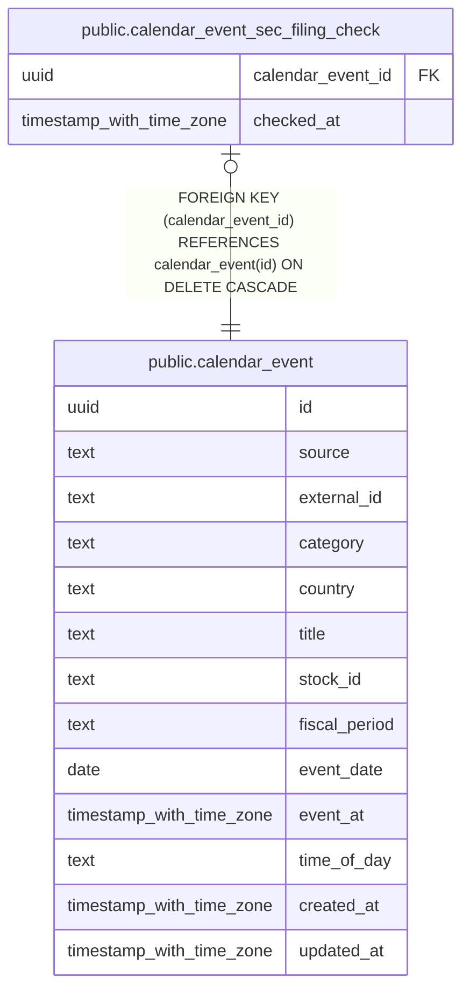

# public.calendar_event_sec_filing_check

## Description

SEC の資料を照合した最終日時をカレンダーイベントごとに保持する。

## Columns

| Name              | Type                     | Default | Nullable | Children | Parents                                           | Comment                                      |
| ----------------- | ------------------------ | ------- | -------- | -------- | ------------------------------------------------- | -------------------------------------------- |
| calendar_event_id | uuid                     |         | false    |          | [public.calendar_event](public.calendar_event.md) | SEC の資料照合対象となるカレンダーイベント。 |
| checked_at        | timestamp with time zone |         | false    |          |                                                   | SEC の照合が正常に完了した日時。             |

## Constraints

| Name                                                       | Type        | Definition                                                                      |
| ---------------------------------------------------------- | ----------- | ------------------------------------------------------------------------------- |
| calendar_event_sec_filing_check_calendar_event_id_not_null | n           | NOT NULL calendar_event_id                                                      |
| calendar_event_sec_filing_check_checked_at_not_null        | n           | NOT NULL checked_at                                                             |
| fk_calendar_event_sec_filing_check_event                   | FOREIGN KEY | FOREIGN KEY (calendar_event_id) REFERENCES calendar_event(id) ON DELETE CASCADE |
| calendar_event_sec_filing_check_pkey                       | PRIMARY KEY | PRIMARY KEY (calendar_event_id)                                                 |

## Indexes

| Name                                 | Definition                                                                                                                         |
| ------------------------------------ | ---------------------------------------------------------------------------------------------------------------------------------- |
| calendar_event_sec_filing_check_pkey | CREATE UNIQUE INDEX calendar_event_sec_filing_check_pkey ON public.calendar_event_sec_filing_check USING btree (calendar_event_id) |

## Relations

---

> Generated by [tbls](https://github.com/k1LoW/tbls)
