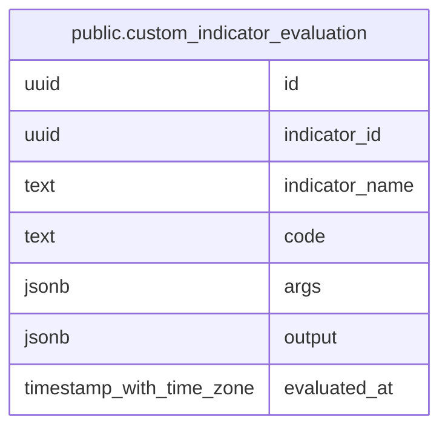

# public.custom_indicator_evaluation

## Description

自作指標の成功した計算結果を、実行時点の定義とともに保持する。

## Columns

| Name           | Type                     | Default | Nullable | Children | Parents | Comment                                               |
| -------------- | ------------------------ | ------- | -------- | -------- | ------- | ----------------------------------------------------- |
| id             | uuid                     |         | false    |          |         |                                                       |
| indicator_id   | uuid                     |         | false    |          |         | 実行時点の自作指標の ID。定義への外部キーは持たない。 |
| indicator_name | text                     |         | false    |          |         | 実行時点の自作指標の名称。                            |
| code           | text                     |         | false    |          |         | 評価時に実行した自作指標のコード。                    |
| args           | jsonb                    |         | false    |          |         | 計算に渡した入力引数を保持する JSON 値。              |
| output         | jsonb                    |         | false    |          |         | 自作指標が返した JSON 値。                            |
| evaluated_at   | timestamp with time zone |         | false    |          |         | 計算が成功した時刻。                                  |

## Constraints

| Name                             | Type        | Definition       |
| -------------------------------- | ----------- | ---------------- |
| custom_indicator_evaluation_pkey | PRIMARY KEY | PRIMARY KEY (id) |

## Indexes

| Name                             | Definition                                                                                                  |
| -------------------------------- | ----------------------------------------------------------------------------------------------------------- |
| custom_indicator_evaluation_pkey | CREATE UNIQUE INDEX custom_indicator_evaluation_pkey ON public.custom_indicator_evaluation USING btree (id) |

## Relations

---

> Generated by [tbls](https://github.com/k1LoW/tbls)
