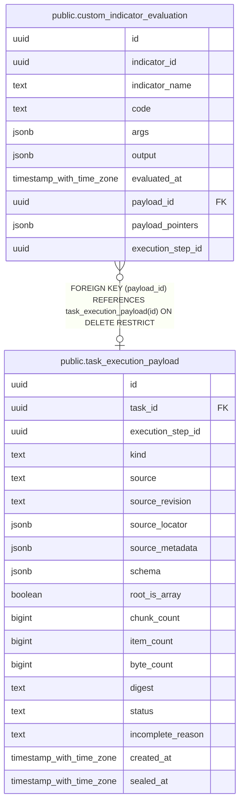

# public.custom_indicator_evaluation

## Description

自作指標の成功した計算結果を、実行時点の定義とともに保持する。

## Columns

| Name              | Type                     | Default | Nullable | Children | Parents                                                           | Comment                                                    |
| ----------------- | ------------------------ | ------- | -------- | -------- | ----------------------------------------------------------------- | ---------------------------------------------------------- |
| id                | uuid                     |         | false    |          |                                                                   |                                                            |
| indicator_id      | uuid                     |         | false    |          |                                                                   | 実行時点の自作指標の ID。定義への外部キーは持たない。      |
| indicator_name    | text                     |         | false    |          |                                                                   | 実行時点の自作指標の名称。                                 |
| code              | text                     |         | false    |          |                                                                   | 評価時に実行した自作指標のコード。                         |
| args              | jsonb                    |         | false    |          |                                                                   | 計算に渡した入力引数を保持する JSON 値。                   |
| output            | jsonb                    |         | false    |          |                                                                   | 自作指標が返した JSON 値。                                 |
| evaluated_at      | timestamp with time zone |         | false    |          |                                                                   | 計算が成功した時刻。                                       |
| payload_id        | uuid                     |         | true     |          | [public.task_execution_payload](public.task_execution_payload.md) | 完全な評価出力を保持する task payload。                    |
| payload_pointers  | jsonb                    |         | true     |          |                                                                   | evaluation の数値出力名と payload 内 JSON Pointer の対応。 |
| execution_step_id | uuid                     |         | true     |          |                                                                   | 評価を実行した task step の UUID。                         |

## Constraints

| Name                                                | Type        | Definition                                                                        |
| --------------------------------------------------- | ----------- | --------------------------------------------------------------------------------- |
| custom_indicator_evaluation_args_not_null           | n           | NOT NULL args                                                                     |
| custom_indicator_evaluation_code_not_null           | n           | NOT NULL code                                                                     |
| custom_indicator_evaluation_evaluated_at_not_null   | n           | NOT NULL evaluated_at                                                             |
| custom_indicator_evaluation_id_not_null             | n           | NOT NULL id                                                                       |
| custom_indicator_evaluation_indicator_id_not_null   | n           | NOT NULL indicator_id                                                             |
| custom_indicator_evaluation_indicator_name_not_null | n           | NOT NULL indicator_name                                                           |
| custom_indicator_evaluation_output_not_null         | n           | NOT NULL output                                                                   |
| custom_indicator_evaluation_pkey                    | PRIMARY KEY | PRIMARY KEY (id)                                                                  |
| custom_indicator_evaluation_payload_fk              | FOREIGN KEY | FOREIGN KEY (payload_id) REFERENCES task_execution_payload(id) ON DELETE RESTRICT |

## Indexes

| Name                             | Definition                                                                                                  |
| -------------------------------- | ----------------------------------------------------------------------------------------------------------- |
| custom_indicator_evaluation_pkey | CREATE UNIQUE INDEX custom_indicator_evaluation_pkey ON public.custom_indicator_evaluation USING btree (id) |

## Relations

---

> Generated by [tbls](https://github.com/k1LoW/tbls)
