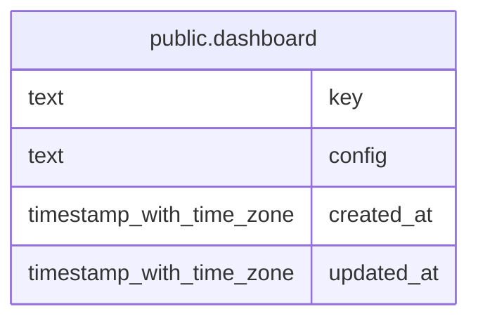

# public.dashboard

## Description

ユーザーが作成したダッシュボードの YAML 設定を保持する。

## Columns

| Name       | Type                     | Default           | Nullable | Children | Parents | Comment                                                     |
| ---------- | ------------------------ | ----------------- | -------- | -------- | ------- | ----------------------------------------------------------- |
| key        | text                     |                   | false    |          |         | ダッシュボードを識別する一意なキー。                        |
| config     | text                     |                   | false    |          |         | title と widgets を含むダッシュボード設定の YAML テキスト。 |
| created_at | timestamp with time zone | CURRENT_TIMESTAMP | false    |          |         |                                                             |
| updated_at | timestamp with time zone | CURRENT_TIMESTAMP | false    |          |         |                                                             |

## Constraints

| Name                          | Type        | Definition          |
| ----------------------------- | ----------- | ------------------- |
| dashboard_config_not_null     | n           | NOT NULL config     |
| dashboard_created_at_not_null | n           | NOT NULL created_at |
| dashboard_key_not_null        | n           | NOT NULL key        |
| dashboard_updated_at_not_null | n           | NOT NULL updated_at |
| dashboard_pkey                | PRIMARY KEY | PRIMARY KEY (key)   |

## Indexes

| Name           | Definition                                                               |
| -------------- | ------------------------------------------------------------------------ |
| dashboard_pkey | CREATE UNIQUE INDEX dashboard_pkey ON public.dashboard USING btree (key) |

## Relations

---

> Generated by [tbls](https://github.com/k1LoW/tbls)
