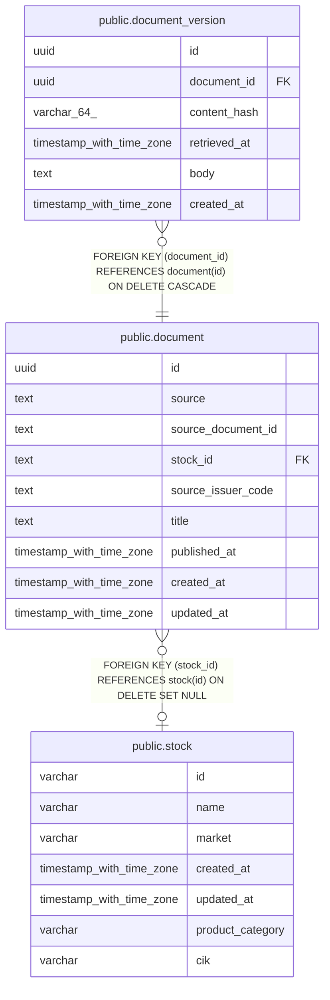

# public.document

## Description

資料源に依存しない公開文書の識別情報を保持する。

## Columns

| Name               | Type                     | Default           | Nullable | Children                                              | Parents                         | Comment                         |
| ------------------ | ------------------------ | ----------------- | -------- | ----------------------------------------------------- | ------------------------------- | ------------------------------- |
| id                 | uuid                     | gen_random_uuid() | false    | [public.document_version](public.document_version.md) |                                 |                                 |
| source             | text                     |                   | false    |                                                       |                                 | 文書を識別する資料源。          |
| source_document_id | text                     |                   | false    |                                                       |                                 | 資料源側で文書を識別する ID。   |
| stock_id           | text                     |                   | true     |                                                       | [public.stock](public.stock.md) | 発行企業を表す登録済み銘柄 ID。 |
| source_issuer_code | text                     |                   | false    |                                                       |                                 | 資料源側の発行者コード。        |
| title              | text                     |                   | false    |                                                       |                                 | 公開文書の題名。                |
| published_at       | timestamp with time zone |                   | false    |                                                       |                                 | 文書が公開された時刻。          |
| created_at         | timestamp with time zone | CURRENT_TIMESTAMP | false    |                                                       |                                 |                                 |
| updated_at         | timestamp with time zone | CURRENT_TIMESTAMP | false    |                                                       |                                 |                                 |

## Constraints

| Name                                 | Type        | Definition                                                     |
| ------------------------------------ | ----------- | -------------------------------------------------------------- |
| document_created_at_not_null         | n           | NOT NULL created_at                                            |
| document_id_not_null                 | n           | NOT NULL id                                                    |
| document_published_at_not_null       | n           | NOT NULL published_at                                          |
| document_source_document_id_not_null | n           | NOT NULL source_document_id                                    |
| document_source_issuer_code_not_null | n           | NOT NULL source_issuer_code                                    |
| document_source_not_null             | n           | NOT NULL source                                                |
| document_title_not_null              | n           | NOT NULL title                                                 |
| document_updated_at_not_null         | n           | NOT NULL updated_at                                            |
| fk_document_stock                    | FOREIGN KEY | FOREIGN KEY (stock_id) REFERENCES stock(id) ON DELETE SET NULL |
| document_pkey                        | PRIMARY KEY | PRIMARY KEY (id)                                               |

## Indexes

| Name                            | Definition                                                                                                      |
| ------------------------------- | --------------------------------------------------------------------------------------------------------------- |
| document_pkey                   | CREATE UNIQUE INDEX document_pkey ON public.document USING btree (id)                                           |
| idx_document_source_document_id | CREATE UNIQUE INDEX idx_document_source_document_id ON public.document USING btree (source, source_document_id) |

## Relations

---

> Generated by [tbls](https://github.com/k1LoW/tbls)
