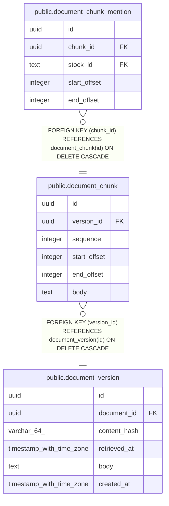

# public.document_chunk

## Description

原文のバージョンに属する順序付き文書片を保持する。

## Columns

| Name         | Type    | Default           | Nullable | Children                                                          | Parents                                               | Comment                                        |
| ------------ | ------- | ----------------- | -------- | ----------------------------------------------------------------- | ----------------------------------------------------- | ---------------------------------------------- |
| id           | uuid    | gen_random_uuid() | false    | [public.document_chunk_mention](public.document_chunk_mention.md) |                                                       |                                                |
| version_id   | uuid    |                   | false    |                                                                   | [public.document_version](public.document_version.md) | 文書片が参照する原文バージョン。               |
| sequence     | integer |                   | false    |                                                                   |                                                       | バージョン内での文書片の順序。                 |
| start_offset | integer |                   | false    |                                                                   |                                                       | 原文中の開始 byte offset。                     |
| end_offset   | integer |                   | false    |                                                                   |                                                       | 原文中の終了 byte offset。終了位置は含まない。 |
| body         | text    |                   | false    |                                                                   |                                                       | 原文から切り出した文書片。                     |

## Constraints

| Name                                 | Type        | Definition                                                                 |
| ------------------------------------ | ----------- | -------------------------------------------------------------------------- |
| document_chunk_body_not_null         | n           | NOT NULL body                                                              |
| document_chunk_check                 | CHECK       | CHECK ((end_offset >= start_offset))                                       |
| document_chunk_end_offset_not_null   | n           | NOT NULL end_offset                                                        |
| document_chunk_id_not_null           | n           | NOT NULL id                                                                |
| document_chunk_sequence_check        | CHECK       | CHECK ((sequence >= 0))                                                    |
| document_chunk_sequence_not_null     | n           | NOT NULL sequence                                                          |
| document_chunk_start_offset_check    | CHECK       | CHECK ((start_offset >= 0))                                                |
| document_chunk_start_offset_not_null | n           | NOT NULL start_offset                                                      |
| document_chunk_version_id_not_null   | n           | NOT NULL version_id                                                        |
| fk_document_chunk_version            | FOREIGN KEY | FOREIGN KEY (version_id) REFERENCES document_version(id) ON DELETE CASCADE |
| document_chunk_pkey                  | PRIMARY KEY | PRIMARY KEY (id)                                                           |

## Indexes

| Name                                | Definition                                                                                                          |
| ----------------------------------- | ------------------------------------------------------------------------------------------------------------------- |
| document_chunk_pkey                 | CREATE UNIQUE INDEX document_chunk_pkey ON public.document_chunk USING btree (id)                                   |
| idx_document_chunk_version_sequence | CREATE UNIQUE INDEX idx_document_chunk_version_sequence ON public.document_chunk USING btree (version_id, sequence) |

## Relations

---

> Generated by [tbls](https://github.com/k1LoW/tbls)
