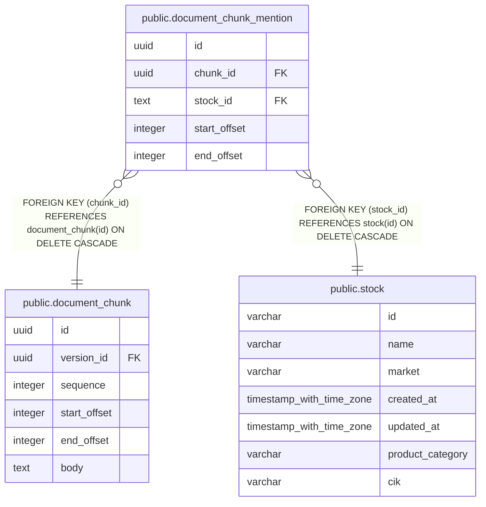

# public.document_chunk_mention

## Description

文書片の本文で照合された登録済み銘柄と範囲を保持する。

## Columns

| Name         | Type    | Default           | Nullable | Children | Parents                                           | Comment                                        |
| ------------ | ------- | ----------------- | -------- | -------- | ------------------------------------------------- | ---------------------------------------------- |
| id           | uuid    | gen_random_uuid() | false    |          |                                                   |                                                |
| chunk_id     | uuid    |                   | false    |          | [public.document_chunk](public.document_chunk.md) | 銘柄名が見つかった文書片。                     |
| stock_id     | text    |                   | false    |          | [public.stock](public.stock.md)                   | 本文中で照合された登録済み銘柄。               |
| start_offset | integer |                   | false    |          |                                                   | 原文中の開始 byte offset。                     |
| end_offset   | integer |                   | false    |          |                                                   | 原文中の終了 byte offset。終了位置は含まない。 |

## Constraints

| Name                                         | Type        | Definition                                                             |
| -------------------------------------------- | ----------- | ---------------------------------------------------------------------- |
| document_chunk_mention_check                 | CHECK       | CHECK ((end_offset > start_offset))                                    |
| document_chunk_mention_chunk_id_not_null     | n           | NOT NULL chunk_id                                                      |
| document_chunk_mention_end_offset_not_null   | n           | NOT NULL end_offset                                                    |
| document_chunk_mention_id_not_null           | n           | NOT NULL id                                                            |
| document_chunk_mention_start_offset_check    | CHECK       | CHECK ((start_offset >= 0))                                            |
| document_chunk_mention_start_offset_not_null | n           | NOT NULL start_offset                                                  |
| document_chunk_mention_stock_id_not_null     | n           | NOT NULL stock_id                                                      |
| fk_document_chunk_mention_stock              | FOREIGN KEY | FOREIGN KEY (stock_id) REFERENCES stock(id) ON DELETE CASCADE          |
| fk_document_chunk_mention_chunk              | FOREIGN KEY | FOREIGN KEY (chunk_id) REFERENCES document_chunk(id) ON DELETE CASCADE |
| document_chunk_mention_pkey                  | PRIMARY KEY | PRIMARY KEY (id)                                                       |

## Indexes

| Name                              | Definition                                                                                                                                        |
| --------------------------------- | ------------------------------------------------------------------------------------------------------------------------------------------------- |
| document_chunk_mention_pkey       | CREATE UNIQUE INDEX document_chunk_mention_pkey ON public.document_chunk_mention USING btree (id)                                                 |
| idx_document_chunk_mention_unique | CREATE UNIQUE INDEX idx_document_chunk_mention_unique ON public.document_chunk_mention USING btree (chunk_id, stock_id, start_offset, end_offset) |

## Relations

---

> Generated by [tbls](https://github.com/k1LoW/tbls)
