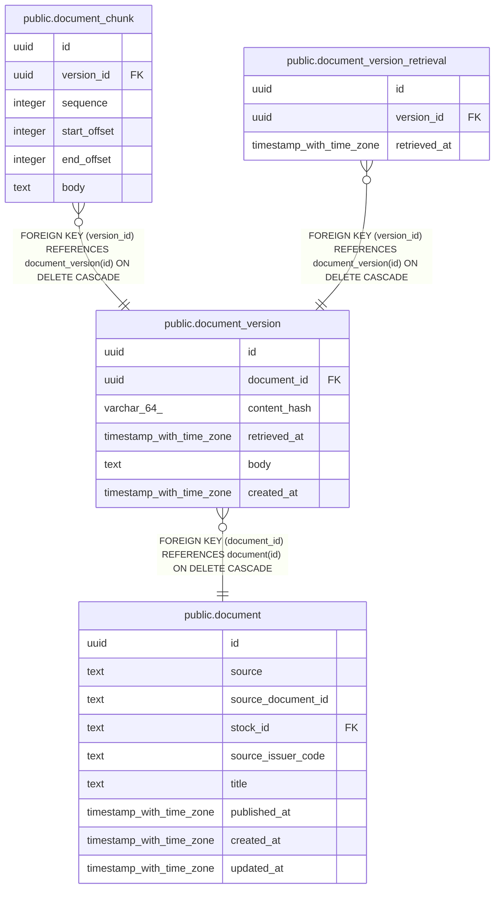

# public.document_version

## Description

hash で重複排除した公開文書の原文を保持する。

## Columns

| Name         | Type                     | Default           | Nullable | Children                                                                                                                    | Parents                               | Comment                            |
| ------------ | ------------------------ | ----------------- | -------- | --------------------------------------------------------------------------------------------------------------------------- | ------------------------------------- | ---------------------------------- |
| id           | uuid                     | gen_random_uuid() | false    | [public.document_chunk](public.document_chunk.md) [public.document_version_retrieval](public.document_version_retrieval.md) |                                       |                                    |
| document_id  | uuid                     |                   | false    |                                                                                                                             | [public.document](public.document.md) | 原文が属する文書。                 |
| content_hash | varchar(64)              |                   | false    |                                                                                                                             |                                       | 原文の SHA-256 hash。              |
| retrieved_at | timestamp with time zone |                   | false    |                                                                                                                             |                                       | 文書バージョンを初回取得した時刻。 |
| body         | text                     |                   | false    |                                                                                                                             |                                       | 取得した原文。                     |
| created_at   | timestamp with time zone | CURRENT_TIMESTAMP | false    |                                                                                                                             |                                       |                                    |

## Constraints

| Name                                   | Type        | Definition                                                          |
| -------------------------------------- | ----------- | ------------------------------------------------------------------- |
| document_version_body_not_null         | n           | NOT NULL body                                                       |
| document_version_content_hash_not_null | n           | NOT NULL content_hash                                               |
| document_version_created_at_not_null   | n           | NOT NULL created_at                                                 |
| document_version_document_id_not_null  | n           | NOT NULL document_id                                                |
| document_version_id_not_null           | n           | NOT NULL id                                                         |
| document_version_retrieved_at_not_null | n           | NOT NULL retrieved_at                                               |
| fk_document_version_document           | FOREIGN KEY | FOREIGN KEY (document_id) REFERENCES document(id) ON DELETE CASCADE |
| document_version_pkey                  | PRIMARY KEY | PRIMARY KEY (id)                                                    |

## Indexes

| Name                                       | Definition                                                                                                                      |
| ------------------------------------------ | ------------------------------------------------------------------------------------------------------------------------------- |
| document_version_pkey                      | CREATE UNIQUE INDEX document_version_pkey ON public.document_version USING btree (id)                                           |
| idx_document_version_document_hash         | CREATE UNIQUE INDEX idx_document_version_document_hash ON public.document_version USING btree (document_id, content_hash)       |
| idx_document_version_document_retrieved_at | CREATE INDEX idx_document_version_document_retrieved_at ON public.document_version USING btree (document_id, retrieved_at DESC) |

## Relations

---

> Generated by [tbls](https://github.com/k1LoW/tbls)
