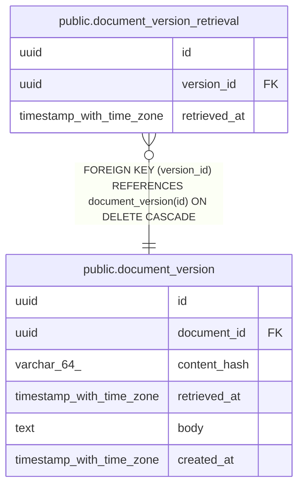

# public.document_version_retrieval

## Description

文書バージョンを取得した各時刻を保持する。

## Columns

| Name         | Type                     | Default           | Nullable | Children | Parents                                               | Comment                  |
| ------------ | ------------------------ | ----------------- | -------- | -------- | ----------------------------------------------------- | ------------------------ |
| id           | uuid                     | gen_random_uuid() | false    |          |                                                       |                          |
| version_id   | uuid                     |                   | false    |          | [public.document_version](public.document_version.md) | 取得した原文バージョン。 |
| retrieved_at | timestamp with time zone |                   | false    |          |                                                       | 原文を取得した時刻。     |

## Constraints

| Name                                             | Type        | Definition                                                                 |
| ------------------------------------------------ | ----------- | -------------------------------------------------------------------------- |
| document_version_retrieval_id_not_null           | n           | NOT NULL id                                                                |
| document_version_retrieval_retrieved_at_not_null | n           | NOT NULL retrieved_at                                                      |
| document_version_retrieval_version_id_not_null   | n           | NOT NULL version_id                                                        |
| fk_document_version_retrieval_version            | FOREIGN KEY | FOREIGN KEY (version_id) REFERENCES document_version(id) ON DELETE CASCADE |
| document_version_retrieval_pkey                  | PRIMARY KEY | PRIMARY KEY (id)                                                           |

## Indexes

| Name                                                | Definition                                                                                                                                        |
| --------------------------------------------------- | ------------------------------------------------------------------------------------------------------------------------------------------------- |
| document_version_retrieval_pkey                     | CREATE UNIQUE INDEX document_version_retrieval_pkey ON public.document_version_retrieval USING btree (id)                                         |
| idx_document_version_retrieval_version_retrieved_at | CREATE INDEX idx_document_version_retrieval_version_retrieved_at ON public.document_version_retrieval USING btree (version_id, retrieved_at DESC) |

## Relations

---

> Generated by [tbls](https://github.com/k1LoW/tbls)
