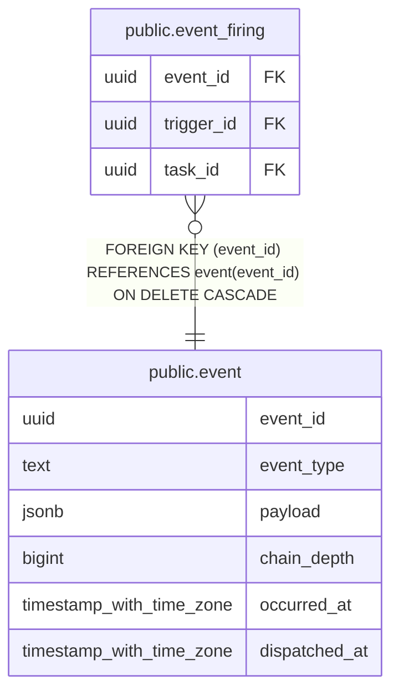

# public.event

## Description

システム内で発生したイベントと dispatch 状態を保持する。

## Columns

| Name          | Type                     | Default           | Nullable | Children                                      | Parents | Comment                                                    |
| ------------- | ------------------------ | ----------------- | -------- | --------------------------------------------- | ------- | ---------------------------------------------------------- |
| event_id      | uuid                     | gen_random_uuid() | false    | [public.event_firing](public.event_firing.md) |         | イベントを識別する ID。                                    |
| event_type    | text                     |                   | false    |                                               |         | イベントを発生させた処理を表す小文字のドット区切り識別子。 |
| payload       | jsonb                    |                   | false    |                                               |         | イベントの内容を表す JSON object。                         |
| chain_depth   | bigint                   | 0                 | false    |                                               |         | イベント起点の trigger が連鎖した段数。                    |
| occurred_at   | timestamp with time zone | CURRENT_TIMESTAMP | false    |                                               |         | イベントが発生した時刻。                                   |
| dispatched_at | timestamp with time zone |                   | true     |                                               |         | イベントを処理済みにした時刻。                             |

## Constraints

| Name                          | Type        | Definition                                                                  |
| ----------------------------- | ----------- | --------------------------------------------------------------------------- |
| event_chain_depth_check       | CHECK       | CHECK ((chain_depth >= 0))                                                  |
| event_event_type_format_check | CHECK       | CHECK ((event_type ~ '^[a-z][a-z0-9_]{0,}([.][a-z][a-z0-9_]{0,})+$'::text)) |
| event_payload_object_check    | CHECK       | CHECK ((jsonb_typeof(payload) = 'object'::text))                            |
| event_pkey                    | PRIMARY KEY | PRIMARY KEY (event_id)                                                      |

## Indexes

| Name                          | Definition                                                                                                         |
| ----------------------------- | ------------------------------------------------------------------------------------------------------------------ |
| event_pkey                    | CREATE UNIQUE INDEX event_pkey ON public.event USING btree (event_id)                                              |
| event_pending_occurred_at_idx | CREATE INDEX event_pending_occurred_at_idx ON public.event USING btree (occurred_at) WHERE (dispatched_at IS NULL) |
| event_occurred_at_idx         | CREATE INDEX event_occurred_at_idx ON public.event USING btree (occurred_at)                                       |

## Relations

---

> Generated by [tbls](https://github.com/k1LoW/tbls)
