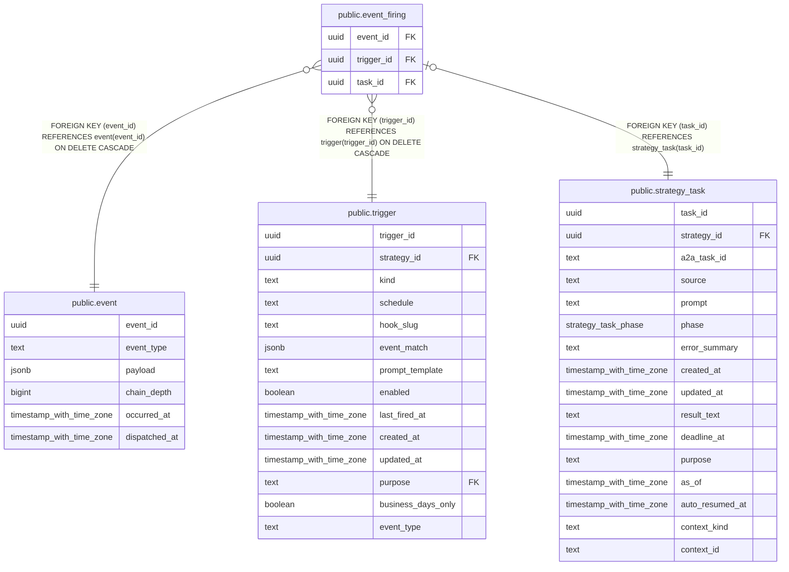

# public.event_firing

## Description

event と trigger の発火、および投入した task の対応を保持する。

## Columns

| Name       | Type | Default | Nullable | Children | Parents                                         | Comment                       |
| ---------- | ---- | ------- | -------- | -------- | ----------------------------------------------- | ----------------------------- |
| event_id   | uuid |         | false    |          | [public.event](public.event.md)                 | 発火元のイベント。            |
| trigger_id | uuid |         | false    |          | [public.trigger](public.trigger.md)             | イベントで起動した trigger。  |
| task_id    | uuid |         | false    |          | [public.strategy_task](public.strategy_task.md) | trigger が投入した戦略 task。 |

## Constraints

| Name                             | Type        | Definition                                                                |
| -------------------------------- | ----------- | ------------------------------------------------------------------------- |
| event_firing_event_id_not_null   | n           | NOT NULL event_id                                                         |
| event_firing_task_id_not_null    | n           | NOT NULL task_id                                                          |
| event_firing_trigger_id_not_null | n           | NOT NULL trigger_id                                                       |
| event_firing_task_id_fkey        | FOREIGN KEY | FOREIGN KEY (task_id) REFERENCES strategy_task(task_id)                   |
| event_firing_trigger_id_fkey     | FOREIGN KEY | FOREIGN KEY (trigger_id) REFERENCES trigger(trigger_id) ON DELETE CASCADE |
| event_firing_event_id_fkey       | FOREIGN KEY | FOREIGN KEY (event_id) REFERENCES event(event_id) ON DELETE CASCADE       |
| event_firing_pkey                | PRIMARY KEY | PRIMARY KEY (event_id, trigger_id)                                        |
| event_firing_task_id_key         | UNIQUE      | UNIQUE (task_id)                                                          |

## Indexes

| Name                        | Definition                                                                                      |
| --------------------------- | ----------------------------------------------------------------------------------------------- |
| event_firing_pkey           | CREATE UNIQUE INDEX event_firing_pkey ON public.event_firing USING btree (event_id, trigger_id) |
| event_firing_task_id_key    | CREATE UNIQUE INDEX event_firing_task_id_key ON public.event_firing USING btree (task_id)       |
| event_firing_trigger_id_idx | CREATE INDEX event_firing_trigger_id_idx ON public.event_firing USING btree (trigger_id)        |

## Relations

---

> Generated by [tbls](https://github.com/k1LoW/tbls)
