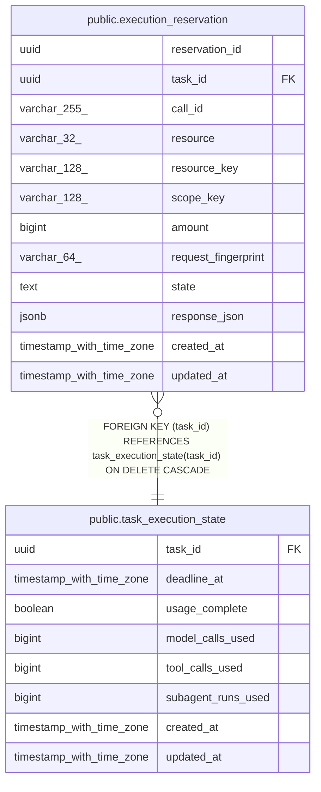

# public.execution_reservation

## Description

task の実行量予約と送信状態を記録する。

## Columns

| Name                | Type                     | Default | Nullable | Children | Parents                                                       | Comment                                          |
| ------------------- | ------------------------ | ------- | -------- | -------- | ------------------------------------------------------------- | ------------------------------------------------ |
| reservation_id      | uuid                     |         | false    |          |                                                               | 予約レコードの識別子。                           |
| task_id             | uuid                     |         | false    |          | [public.task_execution_state](public.task_execution_state.md) | 利用枠を共有する戦略 task。                      |
| call_id             | varchar(255)             |         | false    |          |                                                               | 通信再送を同じ予約へ対応させる呼び出し識別子。   |
| resource            | varchar(32)              |         | false    |          |                                                               | 予約した量の種類。                               |
| resource_key        | varchar(128)             |         | false    |          |                                                               | 上限を適用する対象キー。                         |
| scope_key           | varchar(128)             |         | false    |          |                                                               | 上限を適用する task / step / run の範囲。        |
| amount              | bigint                   |         | false    |          |                                                               | 予約した量。                                     |
| request_fingerprint | varchar(64)              |         | false    |          |                                                               | call_id に結び付けた要求内容の digest。          |
| state               | text                     |         | false    |          |                                                               | 予約、消費、または未送信確認済みの解放状態。     |
| response_json       | jsonb                    |         | true     |          |                                                               | 完了した tool 呼び出しを再送へ返す保存済み応答。 |
| created_at          | timestamp with time zone |         | false    |          |                                                               |                                                  |
| updated_at          | timestamp with time zone |         | false    |          |                                                               |                                                  |

## Constraints

| Name                                                            | Type        | Definition                                                                                                                                             |
| --------------------------------------------------------------- | ----------- | ------------------------------------------------------------------------------------------------------------------------------------------------------ |
| execution_reservation_amount_check                              | CHECK       | CHECK ((amount > 0))                                                                                                                                   |
| execution_reservation_amount_not_null                           | n           | NOT NULL amount                                                                                                                                        |
| execution_reservation_call_id_not_null                          | n           | NOT NULL call_id                                                                                                                                       |
| execution_reservation_created_at_not_null                       | n           | NOT NULL created_at                                                                                                                                    |
| execution_reservation_request_fingerprint_not_null              | n           | NOT NULL request_fingerprint                                                                                                                           |
| execution_reservation_reservation_id_not_null                   | n           | NOT NULL reservation_id                                                                                                                                |
| execution_reservation_resource_check                            | CHECK       | CHECK (((resource)::text = ANY ((ARRAY['model_call'::character varying, 'tool_call'::character varying, 'subagent_run'::character varying])::text[]))) |
| execution_reservation_resource_key_not_null                     | n           | NOT NULL resource_key                                                                                                                                  |
| execution_reservation_resource_not_null                         | n           | NOT NULL resource                                                                                                                                      |
| execution_reservation_scope_key_not_null                        | n           | NOT NULL scope_key                                                                                                                                     |
| execution_reservation_state_check                               | CHECK       | CHECK ((state = ANY (ARRAY['reserved'::text, 'consumed'::text, 'released'::text])))                                                                    |
| execution_reservation_state_not_null                            | n           | NOT NULL state                                                                                                                                         |
| execution_reservation_task_id_not_null                          | n           | NOT NULL task_id                                                                                                                                       |
| execution_reservation_updated_at_not_null                       | n           | NOT NULL updated_at                                                                                                                                    |
| execution_reservation_task_id_fkey                              | FOREIGN KEY | FOREIGN KEY (task_id) REFERENCES task_execution_state(task_id) ON DELETE CASCADE                                                                       |
| execution_reservation_pkey                                      | PRIMARY KEY | PRIMARY KEY (reservation_id)                                                                                                                           |
| execution_reservation_task_id_call_id_resource_key_scope_ke_key | UNIQUE      | UNIQUE (task_id, call_id, resource_key, scope_key)                                                                                                     |

## Indexes

| Name                                                            | Definition                                                                                                                                                                  |
| --------------------------------------------------------------- | --------------------------------------------------------------------------------------------------------------------------------------------------------------------------- |
| execution_reservation_pkey                                      | CREATE UNIQUE INDEX execution_reservation_pkey ON public.execution_reservation USING btree (reservation_id)                                                                 |
| execution_reservation_task_id_call_id_resource_key_scope_ke_key | CREATE UNIQUE INDEX execution_reservation_task_id_call_id_resource_key_scope_ke_key ON public.execution_reservation USING btree (task_id, call_id, resource_key, scope_key) |
| idx_execution_reservation_scope_state                           | CREATE INDEX idx_execution_reservation_scope_state ON public.execution_reservation USING btree (task_id, resource, resource_key, scope_key, state)                          |

## Relations

---

> Generated by [tbls](https://github.com/k1LoW/tbls)
