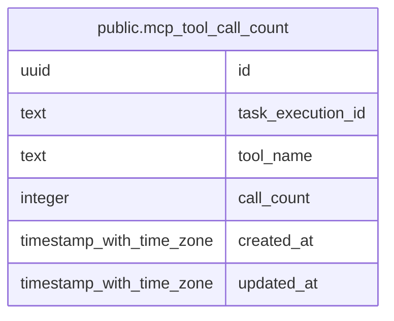

# public.mcp_tool_call_count

## Description

タスク実行ごとの MCP ツール呼び出し数を追跡する。

## Columns

| Name              | Type                     | Default           | Nullable | Children | Parents | Comment                                  |
| ----------------- | ------------------------ | ----------------- | -------- | -------- | ------- | ---------------------------------------- |
| id                | uuid                     | gen_random_uuid() | false    |          |         |                                          |
| task_execution_id | text                     |                   | false    |          |         | 呼び出し数を集計するタスク実行の ID。    |
| tool_name         | text                     |                   | false    |          |         | 呼び出し数を集計する MCP ツール名。      |
| call_count        | integer                  |                   | false    |          |         | タスク実行中に記録したツール呼び出し数。 |
| created_at        | timestamp with time zone | CURRENT_TIMESTAMP | false    |          |         |                                          |
| updated_at        | timestamp with time zone | CURRENT_TIMESTAMP | false    |          |         |                                          |

## Constraints

| Name                                           | Type        | Definition                 |
| ---------------------------------------------- | ----------- | -------------------------- |
| mcp_tool_call_count_call_count_not_null        | n           | NOT NULL call_count        |
| mcp_tool_call_count_created_at_not_null        | n           | NOT NULL created_at        |
| mcp_tool_call_count_id_not_null                | n           | NOT NULL id                |
| mcp_tool_call_count_task_execution_id_not_null | n           | NOT NULL task_execution_id |
| mcp_tool_call_count_tool_name_not_null         | n           | NOT NULL tool_name         |
| mcp_tool_call_count_updated_at_not_null        | n           | NOT NULL updated_at        |
| mcp_tool_call_count_pkey                       | PRIMARY KEY | PRIMARY KEY (id)           |

## Indexes

| Name                              | Definition                                                                                                                     |
| --------------------------------- | ------------------------------------------------------------------------------------------------------------------------------ |
| mcp_tool_call_count_pkey          | CREATE UNIQUE INDEX mcp_tool_call_count_pkey ON public.mcp_tool_call_count USING btree (id)                                    |
| mcp_tool_call_count_task_tool_idx | CREATE UNIQUE INDEX mcp_tool_call_count_task_tool_idx ON public.mcp_tool_call_count USING btree (task_execution_id, tool_name) |

## Relations

---

> Generated by [tbls](https://github.com/k1LoW/tbls)
