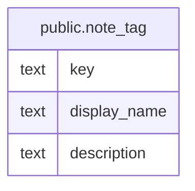

# public.note_tag

## Description

ノートタグの登録語彙と表示情報を定義する。

## Columns

| Name         | Type | Default | Nullable | Children | Parents | Comment                                  |
| ------------ | ---- | ------- | -------- | -------- | ------- | ---------------------------------------- |
| key          | text |         | false    |          |         | ノートに保存されるタグ値を識別するキー。 |
| display_name | text |         | false    |          |         | タグの表示名。                           |
| description  | text |         | true     |          |         | タグの意味と付与基準。                   |

## Constraints

| Name                           | Type        | Definition                           |
| ------------------------------ | ----------- | ------------------------------------ |
| note_tag_display_name_not_null | n           | NOT NULL display_name                |
| note_tag_key_nonblank_check    | CHECK       | CHECK ((key ~ '[^[:space:]]'::text)) |
| note_tag_key_not_null          | n           | NOT NULL key                         |
| note_tag_pkey                  | PRIMARY KEY | PRIMARY KEY (key)                    |

## Indexes

| Name          | Definition                                                             |
| ------------- | ---------------------------------------------------------------------- |
| note_tag_pkey | CREATE UNIQUE INDEX note_tag_pkey ON public.note_tag USING btree (key) |

## Relations

---

> Generated by [tbls](https://github.com/k1LoW/tbls)
