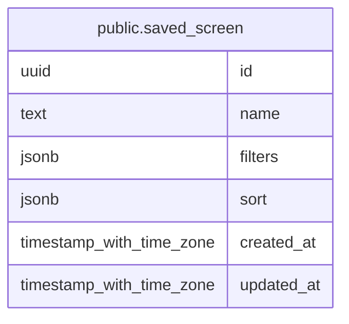

# public.saved_screen

## Description

スクリーナーで保存した名前付き条件と並び順を保持する。

## Columns

| Name       | Type                     | Default           | Nullable | Children | Parents | Comment                              |
| ---------- | ------------------------ | ----------------- | -------- | -------- | ------- | ------------------------------------ |
| id         | uuid                     | gen_random_uuid() | false    |          |         |                                      |
| name       | text                     |                   | false    |          |         | 保存条件を識別する一意な名前。       |
| filters    | jsonb                    | '{}'::jsonb       | false    |          |         | ScreenerFilters 形式の絞り込み条件。 |
| sort       | jsonb                    | '{}'::jsonb       | false    |          |         | ScreenerSort 形式の並び順。          |
| created_at | timestamp with time zone | CURRENT_TIMESTAMP | false    |          |         |                                      |
| updated_at | timestamp with time zone | CURRENT_TIMESTAMP | false    |          |         |                                      |

## Constraints

| Name                             | Type        | Definition          |
| -------------------------------- | ----------- | ------------------- |
| saved_screen_created_at_not_null | n           | NOT NULL created_at |
| saved_screen_filters_not_null    | n           | NOT NULL filters    |
| saved_screen_id_not_null         | n           | NOT NULL id         |
| saved_screen_name_not_null       | n           | NOT NULL name       |
| saved_screen_sort_not_null       | n           | NOT NULL sort       |
| saved_screen_updated_at_not_null | n           | NOT NULL updated_at |
| saved_screen_pkey                | PRIMARY KEY | PRIMARY KEY (id)    |
| saved_screen_name_key            | UNIQUE      | UNIQUE (name)       |

## Indexes

| Name                  | Definition                                                                          |
| --------------------- | ----------------------------------------------------------------------------------- |
| saved_screen_pkey     | CREATE UNIQUE INDEX saved_screen_pkey ON public.saved_screen USING btree (id)       |
| saved_screen_name_key | CREATE UNIQUE INDEX saved_screen_name_key ON public.saved_screen USING btree (name) |

## Relations

---

> Generated by [tbls](https://github.com/k1LoW/tbls)
