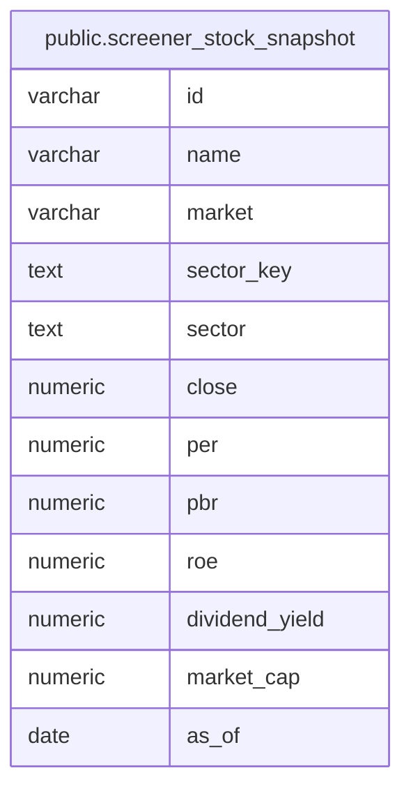

# public.screener_stock_snapshot

## Description

スクリーナー検索に使う銘柄別の最新値を事前計算して保持する。データと銘柄マスタの取り込み成功後に再生成し、個別登録銘柄は次回の再生成後に反映する。

<details>
<summary><strong>Table Definition</strong></summary>

```sql
CREATE MATERIALIZED VIEW screener_stock_snapshot AS (
 WITH latest_any_valuation AS MATERIALIZED (
         SELECT max(valuation.date) AS date
           FROM (valuation
             JOIN stock stock_1 ON (((stock_1.id)::text = "left"((valuation.code)::text, 4))))
        ), latest_daily_timestamp AS (
         SELECT ( SELECT bars."timestamp"
                   FROM (bars
                     JOIN stock stock_1 ON (((stock_1.id)::text = (bars.instrument_id)::text)))
                  WHERE ((bars.timeframe)::text = '1d'::text)
                  ORDER BY bars."timestamp" DESC
                 LIMIT 1) AS "timestamp"
        ), latest_data AS (
         SELECT latest_daily_timestamp."timestamp",
            COALESCE((latest_daily_timestamp."timestamp")::date, ( SELECT latest_any_valuation.date
                   FROM latest_any_valuation)) AS latest_date,
            30 AS lookback_days
           FROM latest_daily_timestamp
        ), latest_valuations AS (
         SELECT DISTINCT ON (("left"((valuation.code)::text, 4))) "left"((valuation.code)::text, 4) AS stock_id,
            valuation.date AS valuation_date,
            valuation.per,
            valuation.pbr,
            (valuation.roe * (100)::numeric) AS roe,
            (valuation.mkt_cap / (100)::numeric) AS market_cap
           FROM ((valuation
             JOIN stock stock_1 ON (((stock_1.id)::text = "left"((valuation.code)::text, 4))))
             CROSS JOIN latest_data)
          WHERE (valuation.date >= (latest_data.latest_date - latest_data.lookback_days))
          ORDER BY ("left"((valuation.code)::text, 4)), valuation.date DESC, valuation.code DESC
        ), latest_bars AS (
         SELECT DISTINCT ON (bars.instrument_id) bars.instrument_id,
            bars.close
           FROM (bars
             JOIN stock stock_1 ON (((stock_1.id)::text = (bars.instrument_id)::text)))
          WHERE (((bars.timeframe)::text = '1d'::text) AND (bars."timestamp" >= ( SELECT (latest_data."timestamp" - ((latest_data.lookback_days)::double precision * '1 day'::interval))
                   FROM latest_data)))
          ORDER BY bars.instrument_id, bars."timestamp" DESC
        ), latest_valuation_date AS (
         SELECT COALESCE(( SELECT max(latest_valuations_1.valuation_date) AS max
                   FROM latest_valuations latest_valuations_1), ( SELECT latest_any_valuation.date
                   FROM latest_any_valuation)) AS as_of
        ), latest_financial_summaries AS (
         SELECT DISTINCT ON (("left"((financial_summary.code)::text, 4))) "left"((financial_summary.code)::text, 4) AS stock_id,
                CASE
                    WHEN ((financial_summary.current_period_type)::text = 'FY'::text) THEN financial_summary.dividend_annual_forecast_next
                    ELSE financial_summary.dividend_annual_forecast
                END AS dividend_annual_forecast
           FROM financial_summary
          WHERE (
                CASE
                    WHEN ((financial_summary.current_period_type)::text = 'FY'::text) THEN financial_summary.dividend_annual_forecast_next
                    ELSE financial_summary.dividend_annual_forecast
                END IS NOT NULL)
          ORDER BY ("left"((financial_summary.code)::text, 4)), financial_summary.disclosure_date DESC, (financial_summary.disclosure_no)::bigint DESC
        ), sectors AS (
         SELECT DISTINCT ON (member.stock_id) member.stock_id,
            stock_group.key AS sector_key,
            stock_group.name AS sector
           FROM ((stock_group_member member
             JOIN stock_group ON ((stock_group.id = member.group_id)))
             JOIN group_axis ON ((group_axis.id = stock_group.axis_id)))
          WHERE (group_axis.derive_from = 'tse_sector33'::text)
          ORDER BY member.stock_id, stock_group.key
        )
 SELECT stock.id,
    stock.name,
    stock.market,
    sectors.sector_key,
    sectors.sector,
    latest_bars.close,
    latest_valuations.per,
    latest_valuations.pbr,
    latest_valuations.roe,
    (((latest_financial_summaries.dividend_annual_forecast)::numeric / NULLIF(latest_bars.close, (0)::numeric)) * (100)::numeric) AS dividend_yield,
    latest_valuations.market_cap,
    latest_valuation_date.as_of
   FROM (((((stock
     LEFT JOIN latest_valuations ON ((latest_valuations.stock_id = (stock.id)::text)))
     LEFT JOIN latest_bars ON (((latest_bars.instrument_id)::text = (stock.id)::text)))
     LEFT JOIN latest_financial_summaries ON ((latest_financial_summaries.stock_id = (stock.id)::text)))
     LEFT JOIN sectors ON (((sectors.stock_id)::text = (stock.id)::text)))
     CROSS JOIN latest_valuation_date)
)
```

</details>

## Columns

| Name           | Type    | Default | Nullable | Children | Parents | Comment                                                |
| -------------- | ------- | ------- | -------- | -------- | ------- | ------------------------------------------------------ |
| id             | varchar |         | true     |          |         |                                                        |
| name           | varchar |         | true     |          |         | 銘柄名。                                               |
| market         | varchar |         | true     |          |         | 市場区分名または外国株の取引所名。                     |
| sector_key     | text    |         | true     |          |         | 銘柄が属する東証 33 業種グループのキー。               |
| sector         | text    |         | true     |          |         | 銘柄が属する東証 33 業種グループ名。                   |
| close          | numeric |         | true     |          |         | 最新日足の終値。                                       |
| per            | numeric |         | true     |          |         | 最新の株価収益率。                                     |
| pbr            | numeric |         | true     |          |         | 最新の株価純資産倍率。                                 |
| roe            | numeric |         | true     |          |         | 最新の自己資本利益率。パーセント単位。                 |
| dividend_yield | numeric |         | true     |          |         | 最新の年間配当予想に基づく配当利回り。パーセント単位。 |
| market_cap     | numeric |         | true     |          |         | 最新の時価総額。億円単位。                             |
| as_of          | date    |         | true     |          |         | スクリーナー全体の最新評価基準日。                     |

## Referenced Tables

| Name                                                        | Columns | Comment                                                                                                | Type       |
| ----------------------------------------------------------- | ------- | ------------------------------------------------------------------------------------------------------ | ---------- |
| [public.valuation](public.valuation.md)                     | 11      | 銘柄ごとの株価評価指標を日付別に保持する。                                                             | BASE TABLE |
| [public.stock](public.stock.md)                             | 7       | ノートや戦略などから参照する銘柄マスタ。銘柄と分類グループの所属関係は stock_group_member で保持する。 | BASE TABLE |
| [public.bars](public.bars.md)                               | 9       | 銘柄ごとの 1 分足、1 時間足、日足の価格と出来高を保持する。                                            | BASE TABLE |
| [latest_daily_timestamp](latest_daily_timestamp.md)         | 0       |                                                                                                        |            |
| [latest_data](latest_data.md)                               | 0       |                                                                                                        |            |
| [latest_valuations](latest_valuations.md)                   | 0       |                                                                                                        |            |
| [public.financial_summary](public.financial_summary.md)     | 37      | 銘柄ごとの決算開示内容と業績予想を保持する。                                                           | BASE TABLE |
| [public.stock_group_member](public.stock_group_member.md)   | 3       | 銘柄と銘柄グループの所属関係を保持する。                                                               | BASE TABLE |
| [public.stock_group](public.stock_group.md)                 | 6       | 分類軸の中で銘柄をまとめるグループを定義する。                                                         | BASE TABLE |
| [public.group_axis](public.group_axis.md)                   | 5       | 銘柄グループを分類する軸を定義する。                                                                   | BASE TABLE |
| [latest_bars](latest_bars.md)                               | 0       |                                                                                                        |            |
| [latest_financial_summaries](latest_financial_summaries.md) | 0       |                                                                                                        |            |
| [sectors](sectors.md)                                       | 0       |                                                                                                        |            |
| [latest_valuation_date](latest_valuation_date.md)           | 0       |                                                                                                        |            |

## Indexes

| Name                                 | Definition                                                                                                  |
| ------------------------------------ | ----------------------------------------------------------------------------------------------------------- |
| screener_stock_snapshot_stock_id_idx | CREATE UNIQUE INDEX screener_stock_snapshot_stock_id_idx ON public.screener_stock_snapshot USING btree (id) |

## Relations



---

> Generated by [tbls](https://github.com/k1LoW/tbls)
