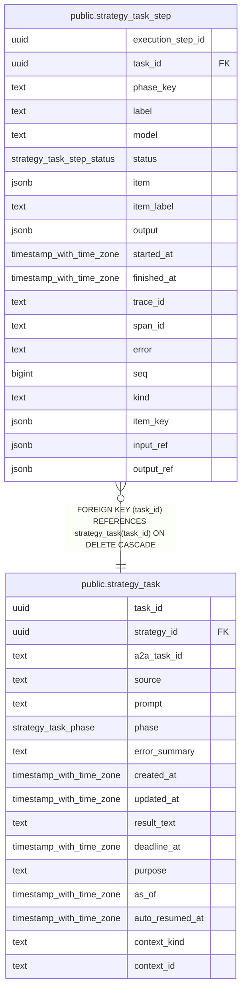

# public.strategy_task_step

## Description

エージェントタスクを構成する実行ステップの状態と結果を記録する。

## Columns

| Name              | Type                      | Default                                         | Nullable | Children | Parents                                         | Comment                                                             |
| ----------------- | ------------------------- | ----------------------------------------------- | -------- | -------- | ----------------------------------------------- | ------------------------------------------------------------------- |
| execution_step_id | uuid                      |                                                 | false    |          |                                                 | 実行ステップを識別する UUID。                                       |
| task_id           | uuid                      |                                                 | false    |          | [public.strategy_task](public.strategy_task.md) | このステップが属するタスク。                                        |
| phase_key         | text                      |                                                 | false    |          |                                                 | 実行グラフ内でフェーズを識別するキー。                              |
| label             | text                      |                                                 | false    |          |                                                 | ステップの表示名。                                                  |
| model             | text                      |                                                 | true     |          |                                                 | LLM ステップに割り当てたモデル識別子。operation ステップでは null。 |
| status            | strategy_task_step_status |                                                 | false    |          |                                                 | ステップの実行状態。                                                |
| item              | jsonb                     |                                                 | true     |          |                                                 | ステップが処理する項目の構造化データ。                              |
| item_label        | text                      |                                                 | true     |          |                                                 | 処理項目の表示名。                                                  |
| output            | jsonb                     |                                                 | true     |          |                                                 | ステップが出力した構造化データ。                                    |
| started_at        | timestamp with time zone  |                                                 | false    |          |                                                 | ステップを開始した時刻。                                            |
| finished_at       | timestamp with time zone  |                                                 | true     |          |                                                 | ステップを終了した時刻。                                            |
| trace_id          | text                      |                                                 | false    |          |                                                 | ステップの分散トレース ID。                                         |
| span_id           | text                      |                                                 | false    |          |                                                 | ステップの分散トレース内の span ID。                                |
| error             | text                      |                                                 | true     |          |                                                 | ステップで発生したエラーの説明。                                    |
| seq               | bigint                    | nextval('strategy_task_step_seq_seq'::regclass) | false    |          |                                                 | タスク内のステップ順序。                                            |
| kind              | text                      | 'llm'::text                                     | false    |          |                                                 | ステップの実行方式。                                                |
| item_key          | jsonb                     |                                                 | true     |          |                                                 | ページ取得した配列項目を再開時に識別するキー。                      |
| input_ref         | jsonb                     |                                                 | true     |          |                                                 | ステップが参照した固定入力 payload と JSON pointer。                |
| output_ref        | jsonb                     |                                                 | true     |          |                                                 | ステップが生成した固定出力 payload と JSON pointer。                |

## Constraints

| Name                                          | Type        | Definition                                                                |
| --------------------------------------------- | ----------- | ------------------------------------------------------------------------- |
| strategy_task_step_execution_step_id_not_null | n           | NOT NULL execution_step_id                                                |
| strategy_task_step_kind_not_null              | n           | NOT NULL kind                                                             |
| strategy_task_step_label_not_null             | n           | NOT NULL label                                                            |
| strategy_task_step_phase_key_not_null         | n           | NOT NULL phase_key                                                        |
| strategy_task_step_seq_not_null               | n           | NOT NULL seq                                                              |
| strategy_task_step_span_id_not_null           | n           | NOT NULL span_id                                                          |
| strategy_task_step_started_at_not_null        | n           | NOT NULL started_at                                                       |
| strategy_task_step_status_not_null            | n           | NOT NULL status                                                           |
| strategy_task_step_task_id_not_null           | n           | NOT NULL task_id                                                          |
| strategy_task_step_trace_id_not_null          | n           | NOT NULL trace_id                                                         |
| strategy_task_step_task_id_fkey               | FOREIGN KEY | FOREIGN KEY (task_id) REFERENCES strategy_task(task_id) ON DELETE CASCADE |
| strategy_task_step_pkey                       | PRIMARY KEY | PRIMARY KEY (execution_step_id)                                           |

## Indexes

| Name                            | Definition                                                                                               |
| ------------------------------- | -------------------------------------------------------------------------------------------------------- |
| strategy_task_step_pkey         | CREATE UNIQUE INDEX strategy_task_step_pkey ON public.strategy_task_step USING btree (execution_step_id) |
| strategy_task_step_task_seq_idx | CREATE INDEX strategy_task_step_task_seq_idx ON public.strategy_task_step USING btree (task_id, seq)     |

## Relations

---

> Generated by [tbls](https://github.com/k1LoW/tbls)
