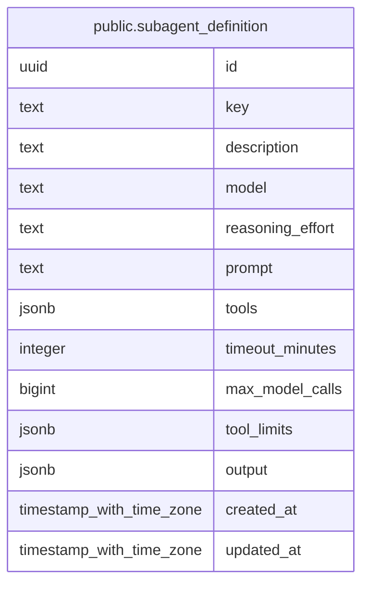

# public.subagent_definition

## Description

戦略設定から独立したサブエージェント定義を保持する。

## Columns

| Name             | Type                     | Default           | Nullable | Children | Parents | Comment                                                 |
| ---------------- | ------------------------ | ----------------- | -------- | -------- | ------- | ------------------------------------------------------- |
| id               | uuid                     | gen_random_uuid() | false    |          |         |                                                         |
| key              | text                     |                   | false    |          |         | 定義を参照するための一意なキー。                        |
| description      | text                     |                   | false    |          |         | 定義の用途を説明するテキスト。                          |
| model            | text                     |                   | false    |          |         | 子エージェントが使用するモデル名。                      |
| reasoning_effort | text                     |                   | true     |          |         | 子エージェントの推論 effort。                           |
| prompt           | text                     |                   | false    |          |         | 子エージェントに渡す指示。                              |
| tools            | jsonb                    | '[]'::jsonb       | false    |          |         | 子エージェントに許可する tool 名の配列。                |
| timeout_minutes  | integer                  |                   | false    |          |         | 子エージェント 1 回の実行時間上限。                     |
| max_model_calls  | bigint                   |                   | false    |          |         | 子エージェント 1 回の実行に許可するモデル呼び出し上限。 |
| tool_limits      | jsonb                    | '{}'::jsonb       | false    |          |         | 子エージェントごとの tool 呼び出し上限。                |
| output           | jsonb                    | '{}'::jsonb       | false    |          |         | 子エージェントが返す JSON Schema。                      |
| created_at       | timestamp with time zone | CURRENT_TIMESTAMP | false    |          |         |                                                         |
| updated_at       | timestamp with time zone | CURRENT_TIMESTAMP | false    |          |         |                                                         |

## Constraints

| Name                                      | Type        | Definition                                                    |
| ----------------------------------------- | ----------- | ------------------------------------------------------------- |
| subagent_definition_max_model_calls_check | CHECK       | CHECK ((max_model_calls > 0))                                 |
| subagent_definition_timeout_minutes_check | CHECK       | CHECK (((timeout_minutes >= 1) AND (timeout_minutes <= 360))) |
| subagent_definition_pkey                  | PRIMARY KEY | PRIMARY KEY (id)                                              |
| subagent_definition_key_key               | UNIQUE      | UNIQUE (key)                                                  |

## Indexes

| Name                        | Definition                                                                                      |
| --------------------------- | ----------------------------------------------------------------------------------------------- |
| subagent_definition_pkey    | CREATE UNIQUE INDEX subagent_definition_pkey ON public.subagent_definition USING btree (id)     |
| subagent_definition_key_key | CREATE UNIQUE INDEX subagent_definition_key_key ON public.subagent_definition USING btree (key) |

## Relations

---

> Generated by [tbls](https://github.com/k1LoW/tbls)
