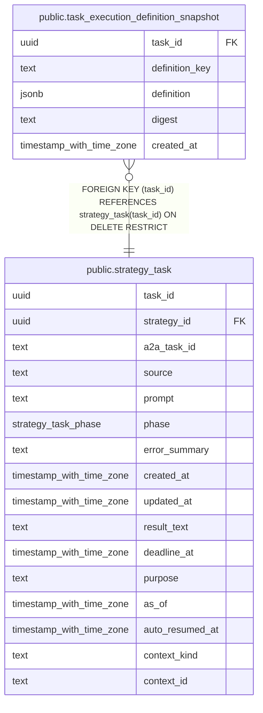

# public.task_execution_definition_snapshot

## Description

task 開始時の設定と初回参照した定義を不変 snapshot として保持する。

## Columns

| Name           | Type                     | Default | Nullable | Children | Parents                                         | Comment                                |
| -------------- | ------------------------ | ------- | -------- | -------- | ----------------------------------------------- | -------------------------------------- |
| task_id        | uuid                     |         | false    |          | [public.strategy_task](public.strategy_task.md) | 定義 snapshot を所有する task。        |
| definition_key | text                     |         | false    |          |                                                 | snapshot 内の定義を識別するキー。      |
| definition     | jsonb                    |         | false    |          |                                                 | 実行で使う定義の保存時点の JSON 内容。 |
| digest         | text                     |         | false    |          |                                                 | definition の SHA-256 digest。         |
| created_at     | timestamp with time zone |         | false    |          |                                                 |                                        |

## Constraints

| Name                                                       | Type        | Definition                                                                 |
| ---------------------------------------------------------- | ----------- | -------------------------------------------------------------------------- |
| task_execution_definition_snapshot_created_at_not_null     | n           | NOT NULL created_at                                                        |
| task_execution_definition_snapshot_definition_key_not_null | n           | NOT NULL definition_key                                                    |
| task_execution_definition_snapshot_definition_not_null     | n           | NOT NULL definition                                                        |
| task_execution_definition_snapshot_digest_not_null         | n           | NOT NULL digest                                                            |
| task_execution_definition_snapshot_task_id_not_null        | n           | NOT NULL task_id                                                           |
| task_execution_definition_snapshot_task_id_fkey            | FOREIGN KEY | FOREIGN KEY (task_id) REFERENCES strategy_task(task_id) ON DELETE RESTRICT |
| task_execution_definition_snapshot_pkey                    | PRIMARY KEY | PRIMARY KEY (task_id, definition_key)                                      |

## Indexes

| Name                                    | Definition                                                                                                                                     |
| --------------------------------------- | ---------------------------------------------------------------------------------------------------------------------------------------------- |
| task_execution_definition_snapshot_pkey | CREATE UNIQUE INDEX task_execution_definition_snapshot_pkey ON public.task_execution_definition_snapshot USING btree (task_id, definition_key) |

## Triggers

| Name                                         | Definition                                                                                                                                                                                                   |
| -------------------------------------------- | ------------------------------------------------------------------------------------------------------------------------------------------------------------------------------------------------------------ |
| task_execution_definition_snapshot_immutable | CREATE TRIGGER task_execution_definition_snapshot_immutable BEFORE DELETE OR UPDATE ON public.task_execution_definition_snapshot FOR EACH ROW EXECUTE FUNCTION reject_execution_definition_snapshot_change() |

## Relations

---

> Generated by [tbls](https://github.com/k1LoW/tbls)
