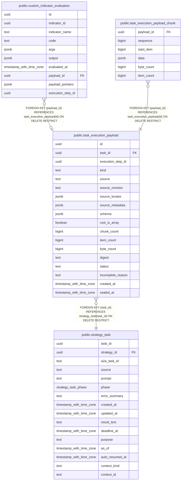

# public.task_execution_payload

## Description

task に属する input/output payload の revision、schema、完全性状態を保持する。

## Columns

| Name              | Type                     | Default         | Nullable | Children                                                                                                                                                  | Parents                                         | Comment                                           |
| ----------------- | ------------------------ | --------------- | -------- | --------------------------------------------------------------------------------------------------------------------------------------------------------- | ----------------------------------------------- | ------------------------------------------------- |
| id                | uuid                     |                 | false    | [public.custom_indicator_evaluation](public.custom_indicator_evaluation.md) [public.task_execution_payload_chunk](public.task_execution_payload_chunk.md) |                                                 |                                                   |
| task_id           | uuid                     |                 | false    |                                                                                                                                                           | [public.strategy_task](public.strategy_task.md) | payload を所有する task。                         |
| execution_step_id | uuid                     |                 | true     |                                                                                                                                                           |                                                 | payload を生成した task step の UUID。            |
| kind              | text                     |                 | false    |                                                                                                                                                           |                                                 | payload の区分。input または output。             |
| source            | text                     |                 | false    |                                                                                                                                                           |                                                 | payload を取得または生成した操作。                |
| source_revision   | text                     |                 | true     |                                                                                                                                                           |                                                 | 取得元が返す revision または保存した定義 digest。 |
| source_locator    | jsonb                    |                 | true     |                                                                                                                                                           |                                                 | 取得元の revision に対応する locator。            |
| source_metadata   | jsonb                    |                 | false    |                                                                                                                                                           |                                                 | 取得元が返す補足情報。                            |
| schema            | jsonb                    |                 | false    |                                                                                                                                                           |                                                 | seal 前に payload 全体へ適用する JSON Schema。    |
| root_is_array     | boolean                  |                 | false    |                                                                                                                                                           |                                                 | payload の root が配列かどうか。                  |
| chunk_count       | bigint                   | 0               | false    |                                                                                                                                                           |                                                 | 保存した順序付き chunk 数。                       |
| item_count        | bigint                   | 0               | false    |                                                                                                                                                           |                                                 | payload に含まれる配列要素数。                    |
| byte_count        | bigint                   | 0               | false    |                                                                                                                                                           |                                                 | payload の JSON byte 数。                         |
| digest            | text                     |                 | true     |                                                                                                                                                           |                                                 | seal 済み payload の SHA-256 digest。             |
| status            | text                     | 'staging'::text | false    |                                                                                                                                                           |                                                 | staging、sealed、incomplete のいずれか。          |
| incomplete_reason | text                     |                 | true     |                                                                                                                                                           |                                                 | payload を完了扱いにできなかった理由。            |
| created_at        | timestamp with time zone |                 | false    |                                                                                                                                                           |                                                 |                                                   |
| sealed_at         | timestamp with time zone |                 | true     |                                                                                                                                                           |                                                 | payload を immutable な sealed 状態にした時刻。   |

## Constraints

| Name                                            | Type        | Definition                                                                                                                                                              |
| ----------------------------------------------- | ----------- | ----------------------------------------------------------------------------------------------------------------------------------------------------------------------- |
| task_execution_payload_byte_count_not_null      | n           | NOT NULL byte_count                                                                                                                                                     |
| task_execution_payload_chunk_count_not_null     | n           | NOT NULL chunk_count                                                                                                                                                    |
| task_execution_payload_counts_check             | CHECK       | CHECK (((chunk_count >= 0) AND (item_count >= 0) AND (byte_count >= 0)))                                                                                                |
| task_execution_payload_created_at_not_null      | n           | NOT NULL created_at                                                                                                                                                     |
| task_execution_payload_id_not_null              | n           | NOT NULL id                                                                                                                                                             |
| task_execution_payload_item_count_not_null      | n           | NOT NULL item_count                                                                                                                                                     |
| task_execution_payload_kind_check               | CHECK       | CHECK ((kind = ANY (ARRAY['input'::text, 'output'::text])))                                                                                                             |
| task_execution_payload_kind_not_null            | n           | NOT NULL kind                                                                                                                                                           |
| task_execution_payload_root_is_array_not_null   | n           | NOT NULL root_is_array                                                                                                                                                  |
| task_execution_payload_schema_not_null          | n           | NOT NULL schema                                                                                                                                                         |
| task_execution_payload_sealed_check             | CHECK       | CHECK ((((status = 'sealed'::text) AND (digest IS NOT NULL) AND (sealed_at IS NOT NULL)) OR ((status <> 'sealed'::text) AND (digest IS NULL) AND (sealed_at IS NULL)))) |
| task_execution_payload_source_metadata_not_null | n           | NOT NULL source_metadata                                                                                                                                                |
| task_execution_payload_source_not_null          | n           | NOT NULL source                                                                                                                                                         |
| task_execution_payload_status_check             | CHECK       | CHECK ((status = ANY (ARRAY['staging'::text, 'sealed'::text, 'incomplete'::text])))                                                                                     |
| task_execution_payload_status_not_null          | n           | NOT NULL status                                                                                                                                                         |
| task_execution_payload_task_id_not_null         | n           | NOT NULL task_id                                                                                                                                                        |
| task_execution_payload_task_id_fkey             | FOREIGN KEY | FOREIGN KEY (task_id) REFERENCES strategy_task(task_id) ON DELETE RESTRICT                                                                                              |
| task_execution_payload_pkey                     | PRIMARY KEY | PRIMARY KEY (id)                                                                                                                                                        |

## Indexes

| Name                                    | Definition                                                                                                                  |
| --------------------------------------- | --------------------------------------------------------------------------------------------------------------------------- |
| task_execution_payload_pkey             | CREATE UNIQUE INDEX task_execution_payload_pkey ON public.task_execution_payload USING btree (id)                           |
| task_execution_payload_task_created_idx | CREATE INDEX task_execution_payload_task_created_idx ON public.task_execution_payload USING btree (task_id, created_at, id) |

## Triggers

| Name                             | Definition                                                                                                                                                         |
| -------------------------------- | ------------------------------------------------------------------------------------------------------------------------------------------------------------------ |
| task_execution_payload_immutable | CREATE TRIGGER task_execution_payload_immutable BEFORE DELETE OR UPDATE ON public.task_execution_payload FOR EACH ROW EXECUTE FUNCTION protect_execution_payload() |

## Relations

---

> Generated by [tbls](https://github.com/k1LoW/tbls)
