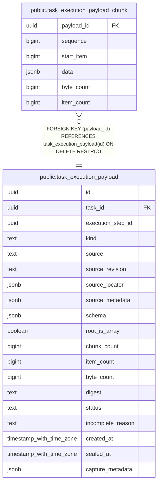

# public.task_execution_payload_chunk

## Description

payload の順序付き JSON chunk を追記専用で保持する。

## Columns

| Name       | Type   | Default | Nullable | Children | Parents                                                           | Comment                                    |
| ---------- | ------ | ------- | -------- | -------- | ----------------------------------------------------------------- | ------------------------------------------ |
| payload_id | uuid   |         | false    |          | [public.task_execution_payload](public.task_execution_payload.md) | chunk が属する payload。                   |
| sequence   | bigint |         | false    |          |                                                                   | payload 内の 0 始まりの chunk 順序。       |
| start_item | bigint |         | false    |          |                                                                   | 配列 payload 内で chunk が始まる要素位置。 |
| data       | jsonb  |         | false    |          |                                                                   | chunk に含まれる JSON 値。                 |
| byte_count | bigint |         | false    |          |                                                                   | chunk の JSON byte 数。                    |
| item_count | bigint |         | false    |          |                                                                   | chunk に含まれる配列要素数。               |

## Constraints

| Name                                             | Type        | Definition                                                                                  |
| ------------------------------------------------ | ----------- | ------------------------------------------------------------------------------------------- |
| task_execution_payload_chunk_byte_count_not_null | n           | NOT NULL byte_count                                                                         |
| task_execution_payload_chunk_counts_check        | CHECK       | CHECK (((sequence >= 0) AND (start_item >= 0) AND (byte_count >= 0) AND (item_count >= 0))) |
| task_execution_payload_chunk_data_not_null       | n           | NOT NULL data                                                                               |
| task_execution_payload_chunk_item_count_not_null | n           | NOT NULL item_count                                                                         |
| task_execution_payload_chunk_payload_id_not_null | n           | NOT NULL payload_id                                                                         |
| task_execution_payload_chunk_sequence_not_null   | n           | NOT NULL sequence                                                                           |
| task_execution_payload_chunk_start_item_not_null | n           | NOT NULL start_item                                                                         |
| task_execution_payload_chunk_payload_id_fkey     | FOREIGN KEY | FOREIGN KEY (payload_id) REFERENCES task_execution_payload(id) ON DELETE RESTRICT           |
| task_execution_payload_chunk_pkey                | PRIMARY KEY | PRIMARY KEY (payload_id, sequence)                                                          |

## Indexes

| Name                                   | Definition                                                                                                                      |
| -------------------------------------- | ------------------------------------------------------------------------------------------------------------------------------- |
| task_execution_payload_chunk_pkey      | CREATE UNIQUE INDEX task_execution_payload_chunk_pkey ON public.task_execution_payload_chunk USING btree (payload_id, sequence) |
| task_execution_payload_chunk_range_idx | CREATE INDEX task_execution_payload_chunk_range_idx ON public.task_execution_payload_chunk USING btree (payload_id, start_item) |

## Triggers

| Name                                      | Definition                                                                                                                                                                                        |
| ----------------------------------------- | ------------------------------------------------------------------------------------------------------------------------------------------------------------------------------------------------- |
| task_execution_payload_chunk_staging_only | CREATE TRIGGER task_execution_payload_chunk_staging_only BEFORE INSERT OR DELETE OR UPDATE ON public.task_execution_payload_chunk FOR EACH ROW EXECUTE FUNCTION protect_execution_payload_chunk() |

## Relations

---

> Generated by [tbls](https://github.com/k1LoW/tbls)
