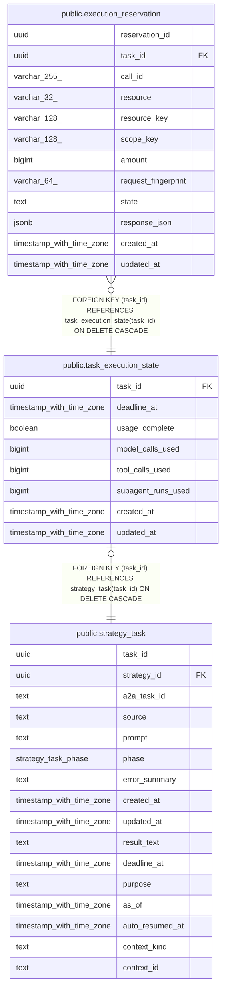

# public.task_execution_state

## Description

戦略 task の固定期限と累計実行量を保持する。

## Columns

| Name               | Type                     | Default | Nullable | Children                                                        | Parents                                         | Comment                                                                                  |
| ------------------ | ------------------------ | ------- | -------- | --------------------------------------------------------------- | ----------------------------------------------- | ---------------------------------------------------------------------------------------- |
| task_id            | uuid                     |         | false    | [public.execution_reservation](public.execution_reservation.md) | [public.strategy_task](public.strategy_task.md) | 利用枠と期限を共有する戦略 task。                                                        |
| deadline_at        | timestamp with time zone |         | false    |                                                                 |                                                 | task 開始時に固定した実行期限。                                                          |
| usage_complete     | boolean                  | true    | false    |                                                                 |                                                 | 移行前の累計実行量が完全に復元できているかを示す。false の task は予約と再開を拒否する。 |
| model_calls_used   | bigint                   | 0       | false    |                                                                 |                                                 | 予約済みまたは消費済みのモデル呼び出し数。                                               |
| tool_calls_used    | bigint                   | 0       | false    |                                                                 |                                                 | 予約済みまたは消費済みの tool 呼び出し数。                                               |
| subagent_runs_used | bigint                   | 0       | false    |                                                                 |                                                 | 予約済みまたは消費済みの子実行数。                                                       |
| created_at         | timestamp with time zone |         | false    |                                                                 |                                                 |                                                                                          |
| updated_at         | timestamp with time zone |         | false    |                                                                 |                                                 |                                                                                          |

## Constraints

| Name                                             | Type        | Definition                                                                |
| ------------------------------------------------ | ----------- | ------------------------------------------------------------------------- |
| task_execution_state_created_at_not_null         | n           | NOT NULL created_at                                                       |
| task_execution_state_deadline_at_not_null        | n           | NOT NULL deadline_at                                                      |
| task_execution_state_model_calls_used_check      | CHECK       | CHECK ((model_calls_used >= 0))                                           |
| task_execution_state_model_calls_used_not_null   | n           | NOT NULL model_calls_used                                                 |
| task_execution_state_subagent_runs_used_check    | CHECK       | CHECK ((subagent_runs_used >= 0))                                         |
| task_execution_state_subagent_runs_used_not_null | n           | NOT NULL subagent_runs_used                                               |
| task_execution_state_task_id_not_null            | n           | NOT NULL task_id                                                          |
| task_execution_state_tool_calls_used_check       | CHECK       | CHECK ((tool_calls_used >= 0))                                            |
| task_execution_state_tool_calls_used_not_null    | n           | NOT NULL tool_calls_used                                                  |
| task_execution_state_updated_at_not_null         | n           | NOT NULL updated_at                                                       |
| task_execution_state_usage_complete_not_null     | n           | NOT NULL usage_complete                                                   |
| task_execution_state_task_id_fkey                | FOREIGN KEY | FOREIGN KEY (task_id) REFERENCES strategy_task(task_id) ON DELETE CASCADE |
| task_execution_state_pkey                        | PRIMARY KEY | PRIMARY KEY (task_id)                                                     |

## Indexes

| Name                      | Definition                                                                                         |
| ------------------------- | -------------------------------------------------------------------------------------------------- |
| task_execution_state_pkey | CREATE UNIQUE INDEX task_execution_state_pkey ON public.task_execution_state USING btree (task_id) |

## Relations

---

> Generated by [tbls](https://github.com/k1LoW/tbls)
