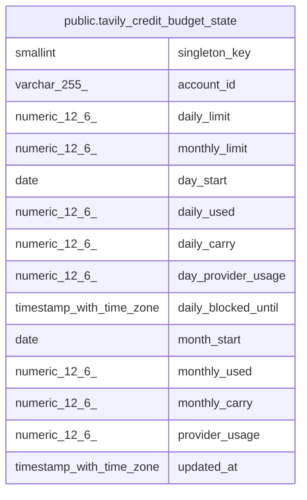

# public.tavily_credit_budget_state

## Description

Tavily account 単位の UTC 日次・月次 credit 上限と照合状態を保持する。

## Columns

| Name                | Type                     | Default | Nullable | Children | Parents | Comment                                                                      |
| ------------------- | ------------------------ | ------- | -------- | -------- | ------- | ---------------------------------------------------------------------------- |
| singleton_key       | smallint                 |         | false    |          |         | account 全体で 1 行だけ保持するための固定キー。                              |
| account_id          | varchar(255)             |         | false    |          |         | key rotation 後も同じ利用枠を共有する安定した account alias。                |
| daily_limit         | numeric(12,6)            |         | false    |          |         | UTC 日次の予約上限。                                                         |
| monthly_limit       | numeric(12,6)            |         | false    |          |         | provider 月次 usage を含む予約上限。                                         |
| day_start           | date                     |         | false    |          |         | 日次利用量を集計する UTC 日付。                                              |
| daily_used          | numeric(12,6)            |         | false    |          |         | 日次の確認済み利用量と未確定予約を含む安全側の利用量。                       |
| daily_carry         | numeric(12,6)            |         | false    |          |         | 前の日次期間から引き継いだ未確定 credit と未照合 provider usage。            |
| day_provider_usage  | numeric(12,6)            |         | false    |          |         | 日次境界で照合した provider 月次利用量。                                     |
| daily_blocked_until | timestamp with time zone |         | true     |          |         | 移行時に日次利用量を復元できない期間の停止期限。                             |
| month_start         | date                     |         | false    |          |         | 月次利用量を集計する UTC 月初日。                                            |
| monthly_used        | numeric(12,6)            |         | false    |          |         | 月次の確認済み利用量、provider usage、および未確定予約を含む安全側の利用量。 |
| monthly_carry       | numeric(12,6)            |         | false    |          |         | 前の月次期間から引き継いだ未確定 credit。                                    |
| provider_usage      | numeric(12,6)            |         | false    |          |         | 最後に確認した account 全体の provider usage。                               |
| updated_at          | timestamp with time zone |         | false    |          |         |                                                                              |

## Constraints

| Name                                                   | Type        | Definition                                   |
| ------------------------------------------------------ | ----------- | -------------------------------------------- |
| tavily_credit_budget_state_account_id_not_null         | n           | NOT NULL account_id                          |
| tavily_credit_budget_state_check                       | CHECK       | CHECK ((daily_carry <= daily_used))          |
| tavily_credit_budget_state_check1                      | CHECK       | CHECK ((monthly_carry <= monthly_used))      |
| tavily_credit_budget_state_daily_carry_check           | CHECK       | CHECK ((daily_carry >= (0)::numeric))        |
| tavily_credit_budget_state_daily_carry_not_null        | n           | NOT NULL daily_carry                         |
| tavily_credit_budget_state_daily_limit_check           | CHECK       | CHECK ((daily_limit > (0)::numeric))         |
| tavily_credit_budget_state_daily_limit_not_null        | n           | NOT NULL daily_limit                         |
| tavily_credit_budget_state_daily_used_check            | CHECK       | CHECK ((daily_used >= (0)::numeric))         |
| tavily_credit_budget_state_daily_used_not_null         | n           | NOT NULL daily_used                          |
| tavily_credit_budget_state_day_provider_usage_check    | CHECK       | CHECK ((day_provider_usage >= (0)::numeric)) |
| tavily_credit_budget_state_day_provider_usage_not_null | n           | NOT NULL day_provider_usage                  |
| tavily_credit_budget_state_day_start_not_null          | n           | NOT NULL day_start                           |
| tavily_credit_budget_state_month_start_not_null        | n           | NOT NULL month_start                         |
| tavily_credit_budget_state_monthly_carry_check         | CHECK       | CHECK ((monthly_carry >= (0)::numeric))      |
| tavily_credit_budget_state_monthly_carry_not_null      | n           | NOT NULL monthly_carry                       |
| tavily_credit_budget_state_monthly_limit_check         | CHECK       | CHECK ((monthly_limit > (0)::numeric))       |
| tavily_credit_budget_state_monthly_limit_not_null      | n           | NOT NULL monthly_limit                       |
| tavily_credit_budget_state_monthly_used_check          | CHECK       | CHECK ((monthly_used >= (0)::numeric))       |
| tavily_credit_budget_state_monthly_used_not_null       | n           | NOT NULL monthly_used                        |
| tavily_credit_budget_state_provider_usage_check        | CHECK       | CHECK ((provider_usage >= (0)::numeric))     |
| tavily_credit_budget_state_provider_usage_not_null     | n           | NOT NULL provider_usage                      |
| tavily_credit_budget_state_singleton_key_check         | CHECK       | CHECK ((singleton_key = 1))                  |
| tavily_credit_budget_state_singleton_key_not_null      | n           | NOT NULL singleton_key                       |
| tavily_credit_budget_state_updated_at_not_null         | n           | NOT NULL updated_at                          |
| tavily_credit_budget_state_pkey                        | PRIMARY KEY | PRIMARY KEY (singleton_key)                  |

## Indexes

| Name                            | Definition                                                                                                           |
| ------------------------------- | -------------------------------------------------------------------------------------------------------------------- |
| tavily_credit_budget_state_pkey | CREATE UNIQUE INDEX tavily_credit_budget_state_pkey ON public.tavily_credit_budget_state USING btree (singleton_key) |

## Relations

---

> Generated by [tbls](https://github.com/k1LoW/tbls)
