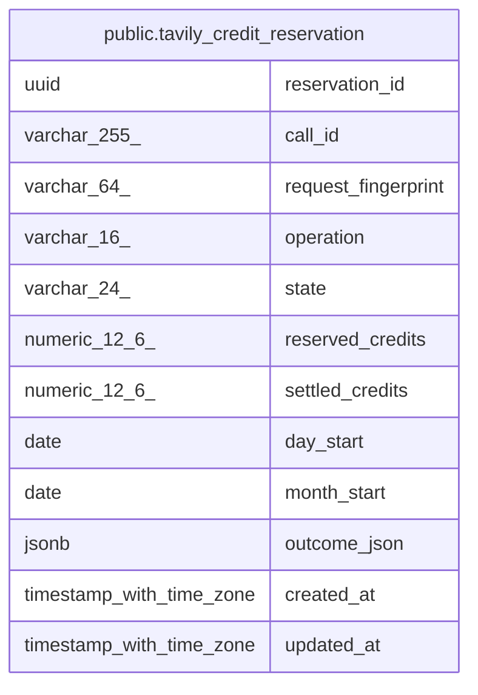

# public.tavily_credit_reservation

## Description

Tavily provider へ送る検索・抽出の account credit 予約、精算、再送結果を保持する。

## Columns

| Name                | Type                     | Default | Nullable | Children | Parents | Comment                                                      |
| ------------------- | ------------------------ | ------- | -------- | -------- | ------- | ------------------------------------------------------------ |
| reservation_id      | uuid                     |         | false    |          |         | credit 予約を識別する ID。                                   |
| call_id             | varchar(255)             |         | false    |          |         | 再送を同じ予約または保存済み結果に対応させる呼び出し識別子。 |
| request_fingerprint | varchar(64)              |         | false    |          |         | call_id に結び付けた要求内容の digest。                      |
| operation           | varchar(16)              |         | false    |          |         | credit を予約した provider 操作。                            |
| state               | varchar(24)              |         | false    |          |         | 未送信予約、送信中、確定、拒否、または結果不明の状態。       |
| reserved_credits    | numeric(12,6)            |         | false    |          |         | 送信前に確保した安全側の credit 数。                         |
| settled_credits     | numeric(12,6)            |         | true     |          |         | provider 応答の usage で確定した credit 数。                 |
| day_start           | date                     |         | false    |          |         | 予約時に適用した UTC 日次期間。                              |
| month_start         | date                     |         | false    |          |         | 予約時に適用した UTC 月次期間。                              |
| outcome_json        | jsonb                    |         | true     |          |         | 同一 call_id の再送へ返す保存済み結果または構造化停止理由。  |
| created_at          | timestamp with time zone |         | false    |          |         |                                                              |
| updated_at          | timestamp with time zone |         | false    |          |         |                                                              |

## Constraints

| Name                                                   | Type        | Definition                                                                                                                                                                                                                                        |
| ------------------------------------------------------ | ----------- | ------------------------------------------------------------------------------------------------------------------------------------------------------------------------------------------------------------------------------------------------- |
| tavily_credit_reservation_call_id_not_null             | n           | NOT NULL call_id                                                                                                                                                                                                                                  |
| tavily_credit_reservation_created_at_not_null          | n           | NOT NULL created_at                                                                                                                                                                                                                               |
| tavily_credit_reservation_day_start_not_null           | n           | NOT NULL day_start                                                                                                                                                                                                                                |
| tavily_credit_reservation_month_start_not_null         | n           | NOT NULL month_start                                                                                                                                                                                                                              |
| tavily_credit_reservation_operation_check              | CHECK       | CHECK (((operation)::text = ANY ((ARRAY['search'::character varying, 'extract'::character varying])::text[])))                                                                                                                                    |
| tavily_credit_reservation_operation_not_null           | n           | NOT NULL operation                                                                                                                                                                                                                                |
| tavily_credit_reservation_request_fingerprint_not_null | n           | NOT NULL request_fingerprint                                                                                                                                                                                                                      |
| tavily_credit_reservation_reservation_id_not_null      | n           | NOT NULL reservation_id                                                                                                                                                                                                                           |
| tavily_credit_reservation_reserved_credits_check       | CHECK       | CHECK ((reserved_credits >= (0)::numeric))                                                                                                                                                                                                        |
| tavily_credit_reservation_reserved_credits_not_null    | n           | NOT NULL reserved_credits                                                                                                                                                                                                                         |
| tavily_credit_reservation_settled_credits_check        | CHECK       | CHECK (((settled_credits IS NULL) OR (settled_credits >= (0)::numeric)))                                                                                                                                                                          |
| tavily_credit_reservation_state_check                  | CHECK       | CHECK (((state)::text = ANY ((ARRAY['prepared'::character varying, 'dispatching'::character varying, 'settled'::character varying, 'unknown'::character varying, 'provider_rejected'::character varying, 'denied'::character varying])::text[]))) |
| tavily_credit_reservation_state_not_null               | n           | NOT NULL state                                                                                                                                                                                                                                    |
| tavily_credit_reservation_updated_at_not_null          | n           | NOT NULL updated_at                                                                                                                                                                                                                               |
| tavily_credit_reservation_pkey                         | PRIMARY KEY | PRIMARY KEY (reservation_id)                                                                                                                                                                                                                      |
| tavily_credit_reservation_call_id_key                  | UNIQUE      | UNIQUE (call_id)                                                                                                                                                                                                                                  |

## Indexes

| Name                                       | Definition                                                                                                                              |
| ------------------------------------------ | --------------------------------------------------------------------------------------------------------------------------------------- |
| tavily_credit_reservation_pkey             | CREATE UNIQUE INDEX tavily_credit_reservation_pkey ON public.tavily_credit_reservation USING btree (reservation_id)                     |
| tavily_credit_reservation_call_id_key      | CREATE UNIQUE INDEX tavily_credit_reservation_call_id_key ON public.tavily_credit_reservation USING btree (call_id)                     |
| idx_tavily_credit_reservation_period_state | CREATE INDEX idx_tavily_credit_reservation_period_state ON public.tavily_credit_reservation USING btree (month_start, day_start, state) |
| idx_tavily_credit_reservation_day_state    | CREATE INDEX idx_tavily_credit_reservation_day_state ON public.tavily_credit_reservation USING btree (day_start, state)                 |
| idx_tavily_credit_reservation_month_state  | CREATE INDEX idx_tavily_credit_reservation_month_state ON public.tavily_credit_reservation USING btree (month_start, state)             |

## Relations

---

> Generated by [tbls](https://github.com/k1LoW/tbls)
