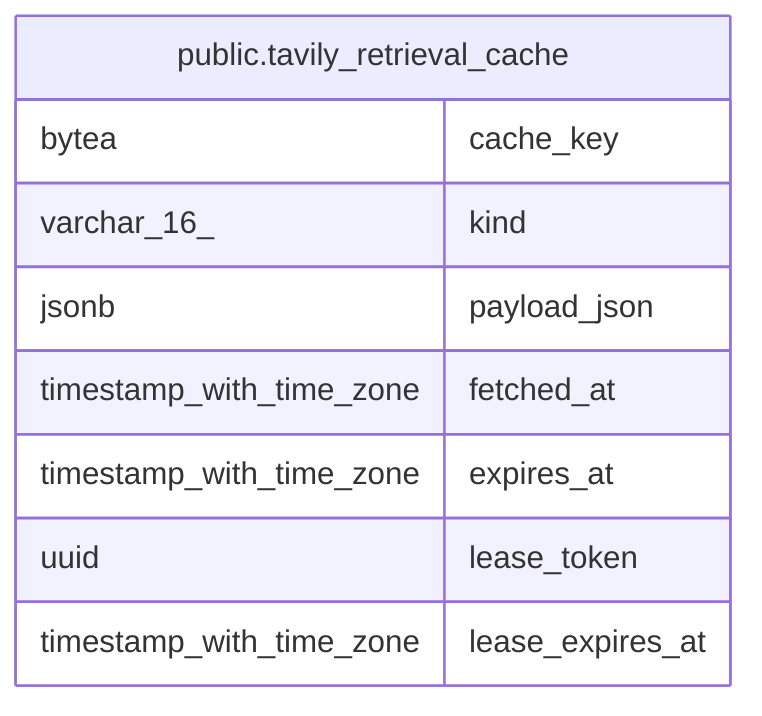

# public.tavily_retrieval_cache

## Description

認可範囲と credential 世代で分離した Tavily 検索結果と抽出本文の有効期間付き cache を保持する。

## Columns

| Name             | Type                     | Default | Nullable | Children | Parents | Comment                                                                            |
| ---------------- | ------------------------ | ------- | -------- | -------- | ------- | ---------------------------------------------------------------------------------- |
| cache_key        | bytea                    |         | false    |          |         | 要求・認可範囲・credential 世代から生成した固定長 digest。元の要求値は保存しない。 |
| kind             | varchar(16)              |         | false    |          |         | cache した取得操作の種類。                                                         |
| payload_json     | jsonb                    |         | true     |          |         | 取得済みの検索結果または抽出本文。取得 claim 中は null。                           |
| fetched_at       | timestamp with time zone |         | true     |          |         | 外部 provider から取得した時刻。取得 claim 中は null。                             |
| expires_at       | timestamp with time zone |         | true     |          |         | cache entry の有効期限。取得 claim 中は null。                                     |
| lease_token      | uuid                     |         | true     |          |         | 取得 claim の所有者を識別する token。結果保存後は null。                           |
| lease_expires_at | timestamp with time zone |         | true     |          |         | 取得 claim の期限。結果保存後は null。                                             |

## Constraints

| Name                                      | Type        | Definition                                                                                                                                                                                                                                                                                                                             |
| ----------------------------------------- | ----------- | -------------------------------------------------------------------------------------------------------------------------------------------------------------------------------------------------------------------------------------------------------------------------------------------------------------------------------------- |
| tavily_retrieval_cache_cache_key_check    | CHECK       | CHECK ((octet_length(cache_key) = 32))                                                                                                                                                                                                                                                                                                 |
| tavily_retrieval_cache_cache_key_not_null | n           | NOT NULL cache_key                                                                                                                                                                                                                                                                                                                     |
| tavily_retrieval_cache_check              | CHECK       | CHECK ((((payload_json IS NOT NULL) AND (fetched_at IS NOT NULL) AND (expires_at IS NOT NULL) AND (lease_token IS NULL) AND (lease_expires_at IS NULL) AND (expires_at > fetched_at)) OR ((payload_json IS NULL) AND (fetched_at IS NULL) AND (expires_at IS NULL) AND (lease_token IS NOT NULL) AND (lease_expires_at IS NOT NULL)))) |
| tavily_retrieval_cache_kind_check         | CHECK       | CHECK (((kind)::text = ANY ((ARRAY['search'::character varying, 'extract'::character varying])::text[])))                                                                                                                                                                                                                              |
| tavily_retrieval_cache_kind_not_null      | n           | NOT NULL kind                                                                                                                                                                                                                                                                                                                          |
| tavily_retrieval_cache_pkey               | PRIMARY KEY | PRIMARY KEY (cache_key)                                                                                                                                                                                                                                                                                                                |

## Indexes

| Name                                  | Definition                                                                                                   |
| ------------------------------------- | ------------------------------------------------------------------------------------------------------------ |
| tavily_retrieval_cache_pkey           | CREATE UNIQUE INDEX tavily_retrieval_cache_pkey ON public.tavily_retrieval_cache USING btree (cache_key)     |
| idx_tavily_retrieval_cache_expires_at | CREATE INDEX idx_tavily_retrieval_cache_expires_at ON public.tavily_retrieval_cache USING btree (expires_at) |

## Relations

---

> Generated by [tbls](https://github.com/k1LoW/tbls)
