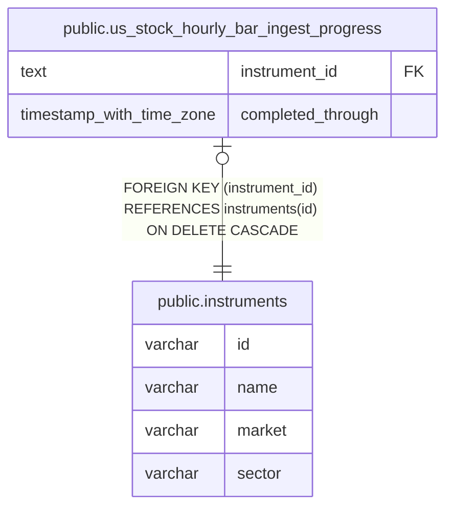

# public.us_stock_hourly_bar_ingest_progress

## Description

米国株の 1 時間足を取得済みの終端時刻を保持する。

## Columns

| Name              | Type                     | Default | Nullable | Children | Parents                                     | Comment                                      |
| ----------------- | ------------------------ | ------- | -------- | -------- | ------------------------------------------- | -------------------------------------------- |
| instrument_id     | text                     |         | false    |          | [public.instruments](public.instruments.md) | 取得対象の銘柄。                             |
| completed_through | timestamp with time zone |         | false    |          |                                             | この時刻まで 1 時間足 API の取得が完了した。 |

## Constraints

| Name                                                   | Type        | Definition                                                               |
| ------------------------------------------------------ | ----------- | ------------------------------------------------------------------------ |
| us_stock_hourly_bar_ingest_progress_instrument_id_fkey | FOREIGN KEY | FOREIGN KEY (instrument_id) REFERENCES instruments(id) ON DELETE CASCADE |
| us_stock_hourly_bar_ingest_progress_pkey               | PRIMARY KEY | PRIMARY KEY (instrument_id)                                              |

## Indexes

| Name                                     | Definition                                                                                                                             |
| ---------------------------------------- | -------------------------------------------------------------------------------------------------------------------------------------- |
| us_stock_hourly_bar_ingest_progress_pkey | CREATE UNIQUE INDEX us_stock_hourly_bar_ingest_progress_pkey ON public.us_stock_hourly_bar_ingest_progress USING btree (instrument_id) |

## Relations

---

> Generated by [tbls](https://github.com/k1LoW/tbls)
