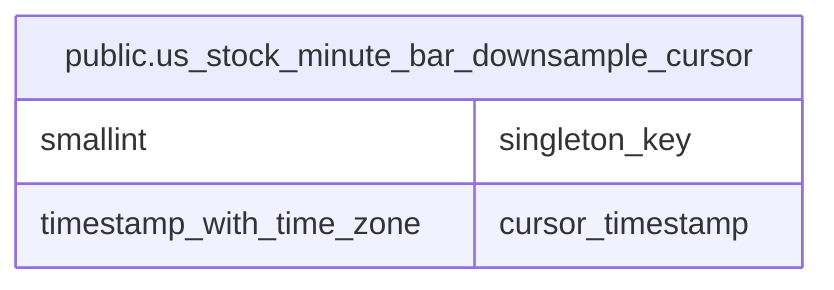

# public.us_stock_minute_bar_downsample_cursor

## Description

米国株の 1 分足 downsample の再開位置を保持する。

## Columns

| Name             | Type                     | Default | Nullable | Children | Parents | Comment                                                 |
| ---------------- | ------------------------ | ------- | -------- | -------- | ------- | ------------------------------------------------------- |
| singleton_key    | smallint                 |         | false    |          |         | 単一行を識別する固定キー。                              |
| cursor_timestamp | timestamp with time zone |         | false    |          |         | この時刻より前に米国株の 1 分足が存在しないことを示す。 |

## Constraints

| Name                                                            | Type        | Definition                  |
| --------------------------------------------------------------- | ----------- | --------------------------- |
| us_stock_minute_bar_downsample_cursor_cursor_timestamp_not_null | n           | NOT NULL cursor_timestamp   |
| us_stock_minute_bar_downsample_cursor_singleton_key_check       | CHECK       | CHECK ((singleton_key = 1)) |
| us_stock_minute_bar_downsample_cursor_singleton_key_not_null    | n           | NOT NULL singleton_key      |
| us_stock_minute_bar_downsample_cursor_pkey                      | PRIMARY KEY | PRIMARY KEY (singleton_key) |

## Indexes

| Name                                       | Definition                                                                                                                                 |
| ------------------------------------------ | ------------------------------------------------------------------------------------------------------------------------------------------ |
| us_stock_minute_bar_downsample_cursor_pkey | CREATE UNIQUE INDEX us_stock_minute_bar_downsample_cursor_pkey ON public.us_stock_minute_bar_downsample_cursor USING btree (singleton_key) |

## Relations

---

> Generated by [tbls](https://github.com/k1LoW/tbls)
