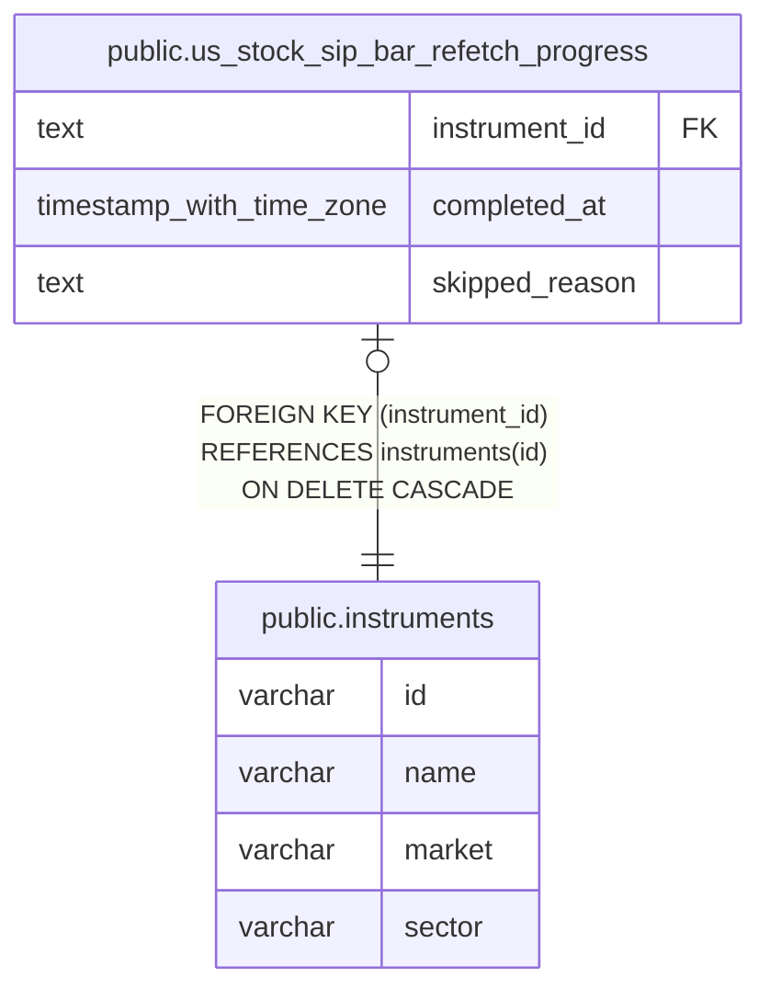

# public.us_stock_sip_bar_refetch_progress

## Description

米国株の SIP 足を再取得した銘柄と、再取得できない理由を保持する。

## Columns

| Name           | Type                     | Default | Nullable | Children | Parents                                     | Comment                                    |
| -------------- | ------------------------ | ------- | -------- | -------- | ------------------------------------------- | ------------------------------------------ |
| instrument_id  | text                     |         | false    |          | [public.instruments](public.instruments.md) | SIP 足を再取得する銘柄。                   |
| completed_at   | timestamp with time zone |         | true     |          |                                             | 指定期間の足を SIP で再取得した時刻。      |
| skipped_reason | text                     |         | true     |          |                                             | SIP で再取得できず、対象から除外した理由。 |

## Constraints

| Name                                                 | Type        | Definition                                                               |
| ---------------------------------------------------- | ----------- | ------------------------------------------------------------------------ |
| us_stock_sip_bar_refetch_progress_check              | CHECK       | CHECK (((completed_at IS NOT NULL) OR (skipped_reason IS NOT NULL)))     |
| us_stock_sip_bar_refetch_progress_check1             | CHECK       | CHECK (((completed_at IS NULL) OR (skipped_reason IS NULL)))             |
| us_stock_sip_bar_refetch_progress_instrument_id_fkey | FOREIGN KEY | FOREIGN KEY (instrument_id) REFERENCES instruments(id) ON DELETE CASCADE |
| us_stock_sip_bar_refetch_progress_pkey               | PRIMARY KEY | PRIMARY KEY (instrument_id)                                              |

## Indexes

| Name                                   | Definition                                                                                                                         |
| -------------------------------------- | ---------------------------------------------------------------------------------------------------------------------------------- |
| us_stock_sip_bar_refetch_progress_pkey | CREATE UNIQUE INDEX us_stock_sip_bar_refetch_progress_pkey ON public.us_stock_sip_bar_refetch_progress USING btree (instrument_id) |

## Relations

---

> Generated by [tbls](https://github.com/k1LoW/tbls)
