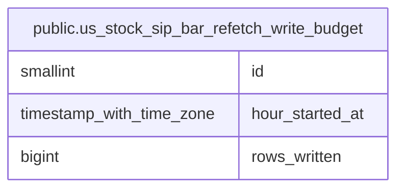

# public.us_stock_sip_bar_refetch_write_budget

## Description

米国株 SIP 足の再取得で時間ごとに書き込んだ行数を保持する。

## Columns

| Name            | Type                     | Default | Nullable | Children | Parents | Comment                                   |
| --------------- | ------------------------ | ------- | -------- | -------- | ------- | ----------------------------------------- |
| id              | smallint                 | 1       | false    |          |         |                                           |
| hour_started_at | timestamp with time zone |         | false    |          |         | 行数を集計する UTC 時間の開始時刻。       |
| rows_written    | bigint                   | 0       | false    |          |         | この時間に SIP 再取得で upsert した行数。 |

## Constraints

| Name                                                           | Type        | Definition                  |
| -------------------------------------------------------------- | ----------- | --------------------------- |
| us_stock_sip_bar_refetch_write_budget_hour_started_at_not_null | n           | NOT NULL hour_started_at    |
| us_stock_sip_bar_refetch_write_budget_id_check                 | CHECK       | CHECK ((id = 1))            |
| us_stock_sip_bar_refetch_write_budget_id_not_null              | n           | NOT NULL id                 |
| us_stock_sip_bar_refetch_write_budget_rows_written_check       | CHECK       | CHECK ((rows_written >= 0)) |
| us_stock_sip_bar_refetch_write_budget_rows_written_not_null    | n           | NOT NULL rows_written       |
| us_stock_sip_bar_refetch_write_budget_pkey                     | PRIMARY KEY | PRIMARY KEY (id)            |

## Indexes

| Name                                       | Definition                                                                                                                      |
| ------------------------------------------ | ------------------------------------------------------------------------------------------------------------------------------- |
| us_stock_sip_bar_refetch_write_budget_pkey | CREATE UNIQUE INDEX us_stock_sip_bar_refetch_write_budget_pkey ON public.us_stock_sip_bar_refetch_write_budget USING btree (id) |

## Relations

---

> Generated by [tbls](https://github.com/k1LoW/tbls)
